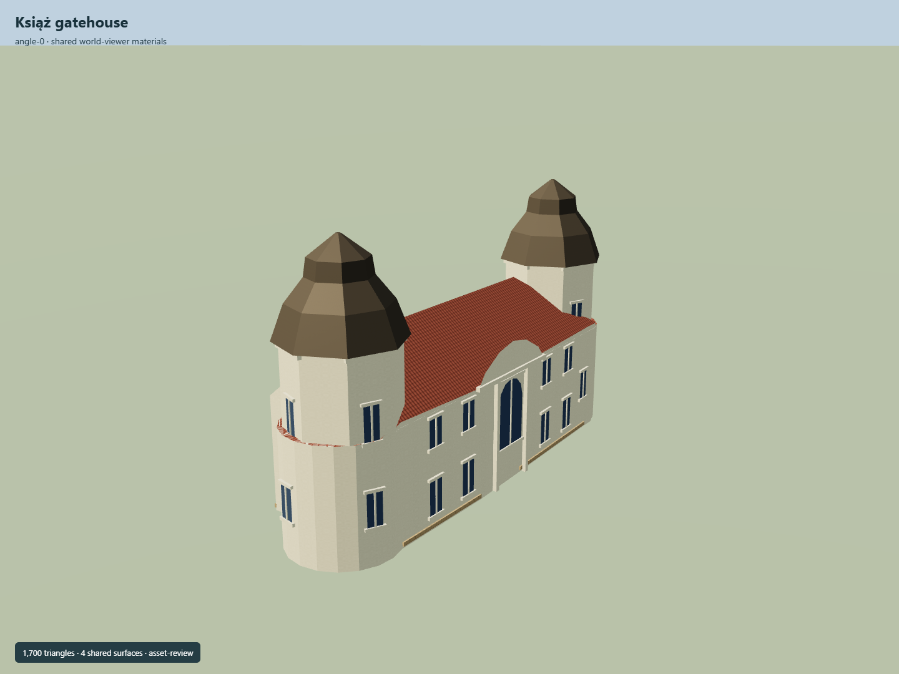

# Książ gatehouse

Cream gatehouse with twin octagonal upper towers,dark faceted domes,red central hip and tall arched library window.

Independently placed component of [Książ Castle and park complex](../ksiaz_castle_and_park_complex/README.md). See the [placement review](QA-REVIEW.md) for the ground fit.

## Sources and reconstruction

- [Reference](https://eli.gov.pl/api/acts/DU/2025/1089/text.pdf)
- [Reference](https://www.ksiazhotel.pl/hotel)
- [Reference](https://ksiazhotel.pl/pokoj-2os-komfort-oficyna)
- [Reference](https://commons.wikimedia.org/wiki/File:Ksiaz_w_jesiennej_scenerii.jpg)
- [Reference](https://www.openstreetmap.org/way/236837152)

Original authored geometry under repository license. Mapped outline © OpenStreetMap contributors,ODbL-1.0;linked research photographs are not redistributed.

The signed mapped ring and facing match the aerial and courtyard photographs. The standard retained Protomaps and Terrarium PMTiles locate the building and set an uncovered 398.95 m terrain contact. An inset sandstone footing follows the perimeter at the visualization datum. The formal library facade faces the outer approach.

## Build

Run node content/worldgen/source/places/u3/u35/ksiaz-entrances/models/generate-ksiaz-entrances.mjs --ids=KSI_A01 (or --check).

1800 triangles;219228 source bytes;5 merged material groups;no embedded images. Shared plaster,tile,sandstone and gatehouse bronze use metric UVs and linear palette tints. Runtime LODs are separate generated outputs.

Source hash: sha256:7ca3751bf75445a42b5bd7cd4af40ec34056eafa291c463e99f82a78c0b215fd
