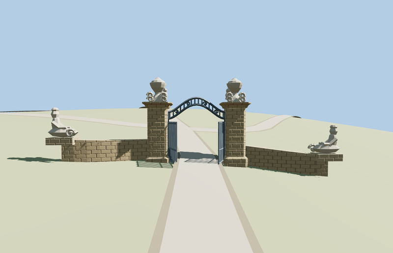

# Książ Hochberg avenue park gate

The sandstone piers carry paired carved urns and a low curved wrought-iron arch. The splayed masonry wings carry the two simplified sphinxes. The gate leaves sit open against the walkway margins.

The fork visible beyond the photographed entrance fixes the sign of the mapped axis. The masonry wings and piers follow sampled original terrain and preserve the paved route through the gate. All four levels keep the path open. 288 traces across the path and 32 low probes against the masonry passed.

The gate preserves every mapped building and transportation line in the fixture. All 37 transportation inputs remain available. Unload disposes the model geometry.

| Detail level | Triangles | Download bytes | Draws |
| --- | ---: | ---: | ---: |
| skyline | 920 | 86,204 | 1 |
| district | 1,556 | 154,028 | 3 |
| street | 4,668 | 467,272 | 3 |
| closeup | 5,340 | 541,612 | 3 |

Skyline and district total 240,232 bytes. Six GLBs validated with zero errors or warnings. Inspected 39 model views and 11 native views. The exterior follows the linked 2014 photograph. Sculptures and dimensions are medium-fi interpretations. The leaves are shown open.

[Placement and terrain controls](map-frame.json) · [Verification report](qa.json) · [Reference photograph](https://www.flickr.com/photos/124589265@N07/14182699172/)
