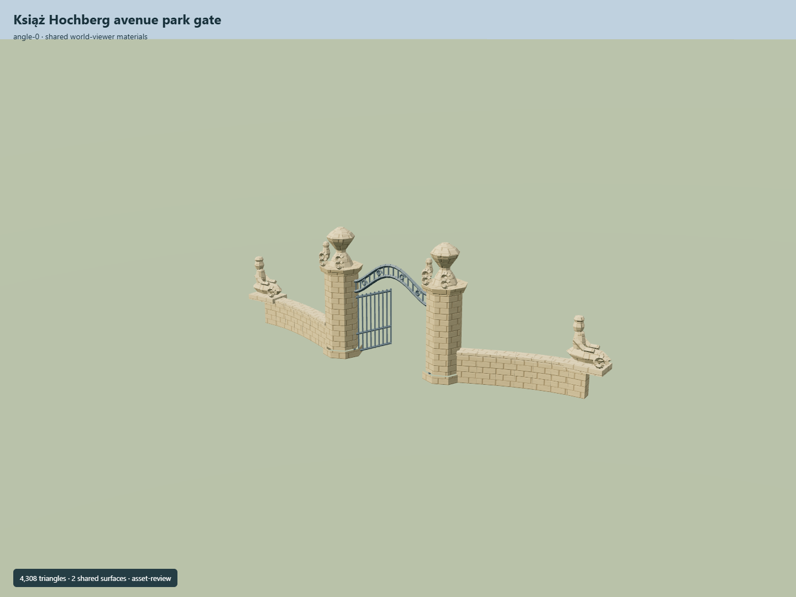

# Książ Hochberg avenue park gate

Chamfered sandstone pillars and urns, curved iron opening and low curved wing walls ending in simplified sphinx-like sculptures.

Independently placed component of [Książ Castle and park complex](../ksiaz_castle_and_park_complex/README.md). See the [placement review](QA-REVIEW.md) for the open approach and foundations.

## Sources and reconstruction

- [Reference](https://eli.gov.pl/api/acts/DU/2025/1089/text.pdf)
- [Reference](https://www.flickr.com/photos/124589265@N07/14182699172/)
- [Reference](https://www.ksiaz.walbrzych.pl/turystyka/aktualnosci/renowacja-drugiej-bramy-w-parku)
- [Reference](https://www.openstreetmap.org/node/2858843969)

Original authored geometry under repository license. Mapped point/path controls © OpenStreetMap contributors,ODbL-1.0;linked research photographs are not redistributed.

The fork beyond the opening fixes the photographed Hochberg Alley facing. The iron leaves are shown open with the paved route retained. Foundations and wings follow the local slope.

## Build

Run node content/worldgen/source/places/u3/u35/ksiaz-park-gates/models/generate-ksiaz-park-gates.mjs --ids=KSI_G02 (or --check).

5340 triangles;643276 source bytes;3 merged material groups;no embedded images. Shared coursed sandstone, raw sandstone carvings and painted metal use metric UVs and linear palette tints. Runtime LODs are separate generated outputs.

Source hash: sha256:b8e55579e43936ed9962e6250f9e6413bb475e02442924190f842259b4766b47
