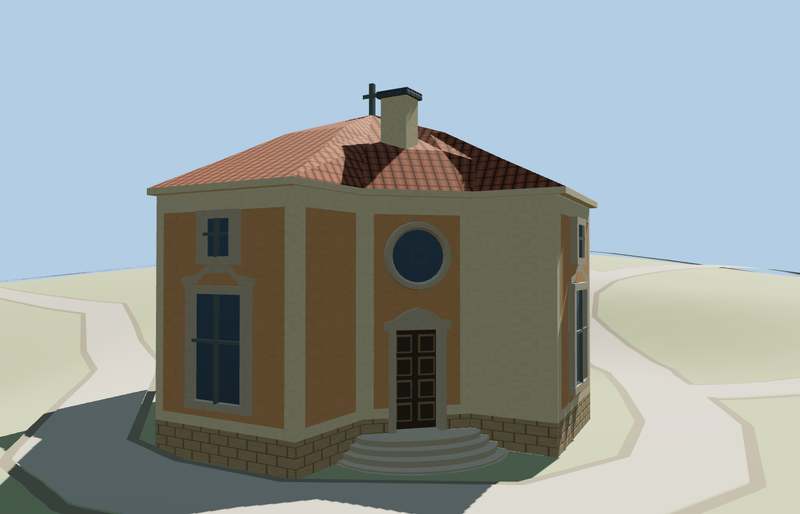

# Hochberg mausoleum at Książ

The cream-and-apricot chapel has a closed mansard roof, a sandstone plinth, recessed paneled doors and a curved stair. The entrance and blind southeast bay each have an oculus, with the radial ironwork retained at close range.

The mapped northwest approach fixes the signed footprint. A small 430.92 m grade exposes the plinth and sets the stair toe. The authored grade follows the appearance of the photographed clearing and blends into the surrounding Terrarium terrain. The stair toe matches the rendered grade within 1 mm at five sampled points across all four levels.

The model replaces only its matched chapel footprint. A failed download restores that mapped building. All 40 transportation inputs remain available. Unload disposes the model geometry.

| Detail level | Triangles | Download bytes | Draws |
| --- | ---: | ---: | ---: |
| skyline | 405 | 36,264 | 1 |
| district | 483 | 49,004 | 7 |
| street | 1,641 | 151,400 | 8 |
| closeup | 2,337 | 209,308 | 8 |

Skyline and district total 85,268 bytes. Six GLBs validated with zero errors or warnings. Inspected 39 model views and 11 native views. The restored exterior follows the linked photographs. The clearing profile is reconstructed. The subterranean crypt and interior remain outside this model.

[Placement and terrain controls](map-frame.json) · [Verification report](qa.json) · [Reference photograph](https://www.labiryntarium.pl/5powiatow/powiat-walbrzyski/1584-mauzoleum-hochbergow.html)
