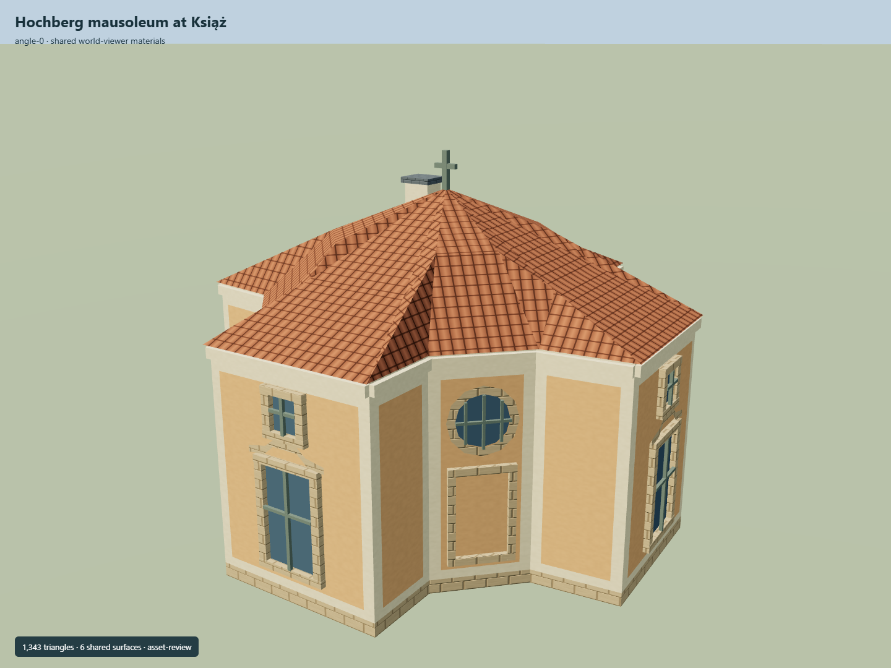

# Hochberg mausoleum at Książ

Stepped octagonal cream-and-apricot pavilion with four circular windows, red mansard roof, sandstone surrounds and a roof cross.

Independently placed component of [Książ Castle and park complex](../ksiaz_castle_and_park_complex/README.md). See the [placement review](QA-REVIEW.md) for the ground fit.

## Sources and reconstruction

- [Reference](https://eli.gov.pl/api/acts/DU/2025/1089/text.pdf)
- [Reference](https://www.bip.ksiaz.walbrzych.pl/wp-content/upLoads/2013/06/Za%C5%82%C4%85cznik-nr-10-Projekt-Budowlany-Mauzoleum-elewacja.pdf)
- [Reference](https://commons.wikimedia.org/wiki/File:Walbrzych_Hochberg_mausoleum_SE_2019.jpg)
- [Reference](https://www.labiryntarium.pl/5powiatow/powiat-walbrzyski/1584-mauzoleum-hochbergow.html)
- [Reference](https://www.ksiaz.walbrzych.pl/turystyka/zwiedzanie/dzienne)
- [Reference](https://www.openstreetmap.org/way/266177054)

Original authored geometry under repository license. Mapped outline © OpenStreetMap contributors,ODbL-1.0;linked research photographs are not redistributed.

Northwest entrance aligns with the mapped approach on the signed chapel footprint. A small grade exposes the photographed stone plinth and aligns the curved steps with the mapped walk through the clearing. Dimensions are photographic estimates.

## Build

Run node content/worldgen/source/places/u3/u35/ksiaz-park-structures/models/generate-ksiaz-park-structures.mjs --ids=KSI_P01 (or --check).

2337 triangles;285052 source bytes;8 merged material groups;no embedded images. Shared plaster, tile, sandstone, rubble, brick, timber and metal use metric UVs and linear palette tints as appropriate to each building. Runtime LODs are separate generated outputs.

Source hash: sha256:7b727560161fe173d658095c340e761b6aea752458f19ab57de4b195c209a516
