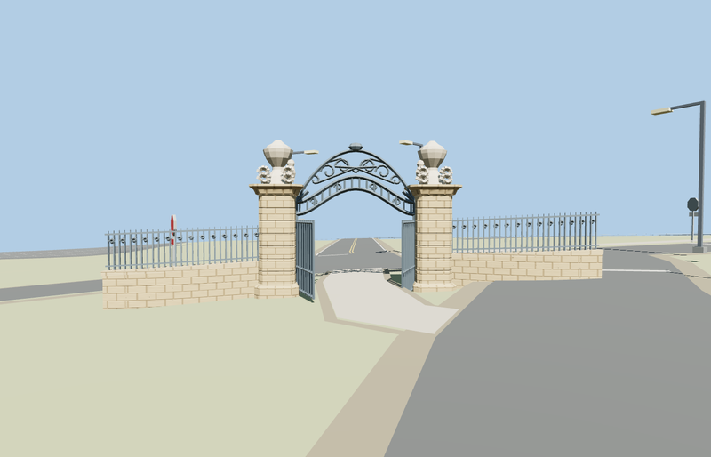

# Książ Jeździecka park gate

The tall wrought-iron crest, side railings and carved urns are visible above the chamfered sandstone piers. The separate iron leaves are open, with the scrollwork restored at street and close-up detail.

The bend beyond the photographed entrance fixes the park-side facing, rotating the original undirected placement by 180 degrees. The bases and walls follow the local slope on either side of the unchanged path. All four levels keep the path open. 288 traces across the path and 32 low probes against the masonry passed.

The gate preserves every mapped building and transportation line in the fixture. All 80 transportation inputs remain available. Unload disposes the model geometry.

| Detail level | Triangles | Download bytes | Draws |
| --- | ---: | ---: | ---: |
| skyline | 924 | 89,060 | 1 |
| district | 1,608 | 161,036 | 3 |
| street | 5,752 | 565,060 | 3 |
| closeup | 11,208 | 1,126,756 | 3 |

Skyline and district total 250,096 bytes. Six GLBs validated with zero errors or warnings. Inspected 39 model views and 11 native views. The exterior follows the linked 2014 photograph. Ornament and dimensions are medium-fi interpretations. The leaves are shown open.

[Placement and terrain controls](map-frame.json) · [Verification report](qa.json) · [Reference photograph](https://www.flickr.com/photos/124589265@N07/13998711268/)
