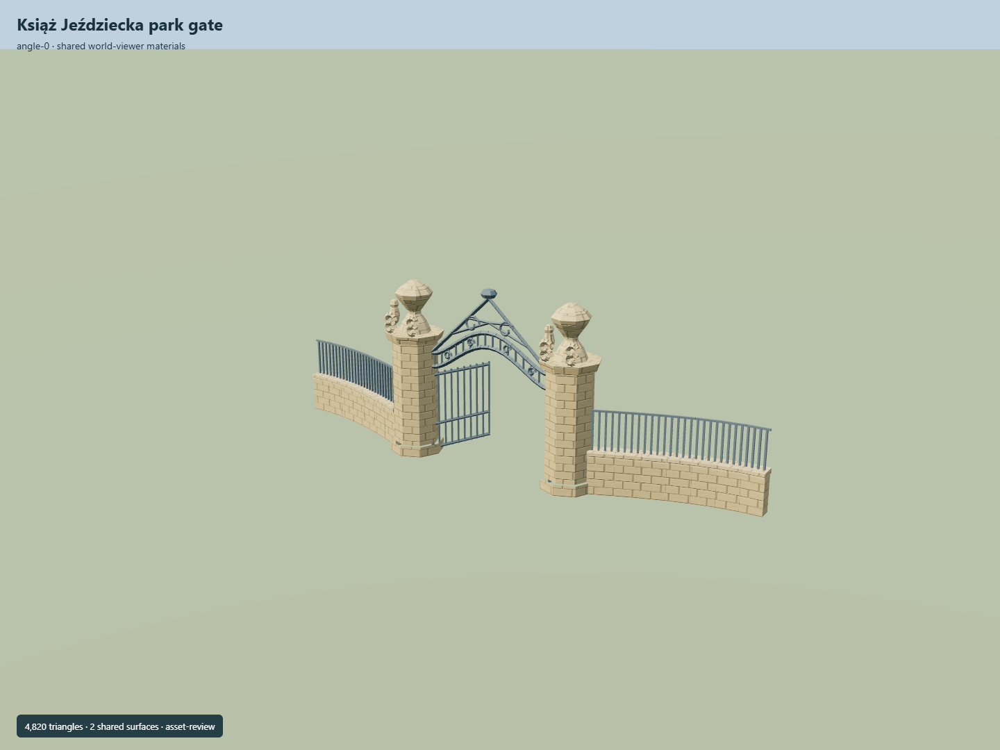

# Książ Jeździecka park gate

Chamfered sandstone pillars and urns supporting a curved iron opening, crowned scroll crest, open leaves and tall wing railings.

Independently placed component of [Książ Castle and park complex](../ksiaz_castle_and_park_complex/README.md). See the [placement review](QA-REVIEW.md) for the open approach and foundations.

## Sources and reconstruction

- [Reference](https://eli.gov.pl/api/acts/DU/2025/1089/text.pdf)
- [Reference](https://www.flickr.com/photos/124589265@N07/13998711268/)
- [Reference](https://www.openstreetmap.org/node/2858843981)

Original authored geometry under repository license. Mapped point/path controls © OpenStreetMap contributors,ODbL-1.0;linked research photographs are not redistributed.

The photographed Jeździecka bend fixes the park-side facing. The iron leaves are shown open across the mapped pedestrian access. Foundations and wings follow the local slope.

## Build

Run node content/worldgen/source/places/u3/u35/ksiaz-park-gates/models/generate-ksiaz-park-gates.mjs --ids=KSI_G01 (or --check).

11208 triangles;1347436 source bytes;3 merged material groups;no embedded images. Shared coursed sandstone, raw sandstone carvings and painted metal use metric UVs and linear palette tints. Runtime LODs are separate generated outputs.

Source hash: sha256:d1a1bb0377bde0a385bbb0a95d6e7900de95e2ee2a17674fe2c9229f11138a7c
