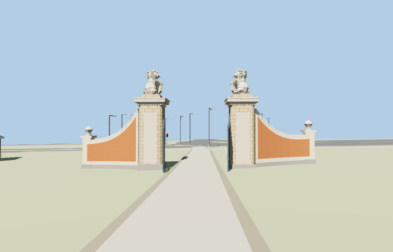

# Książ Lion Gate at Świebodzice

The restored gate has terracotta plaster panels, gray plinths, pale lion-and-shield carvings and urn-topped end posts. The curved walls have continuous coping and the iron leaves sit beside the open walkway.

The view from the park toward the mapped Wałbrzyska and Kasztanowa junction fixes the gate facing. The lions turn toward each other and the town. Both piers and the curved walls follow the retained terrain. All four levels keep the path open. 384 traces across the path and 32 low probes against the masonry passed.

The gate preserves every mapped building and transportation line in the fixture. All 62 transportation inputs remain available. Unload disposes the model geometry.

| Detail level | Triangles | Download bytes | Draws |
| --- | ---: | ---: | ---: |
| skyline | 788 | 77,012 | 1 |
| district | 1,844 | 189,404 | 4 |
| street | 3,532 | 366,660 | 4 |
| closeup | 6,772 | 702,616 | 4 |

Skyline and district total 266,416 bytes. Six GLBs validated with zero errors or warnings. Inspected 39 model views and 12 native views. The restored finish follows photographs from both sides. The sculpture and dimensions are medium-fi estimates. The gate is shown open.

[Placement and terrain controls](map-frame.json) · [Verification report](qa.json) · [Reference photograph](https://www.labiryntarium.pl/7gmin/gminaswiebodzice/698-spacerkiemdoksiaza.html)
