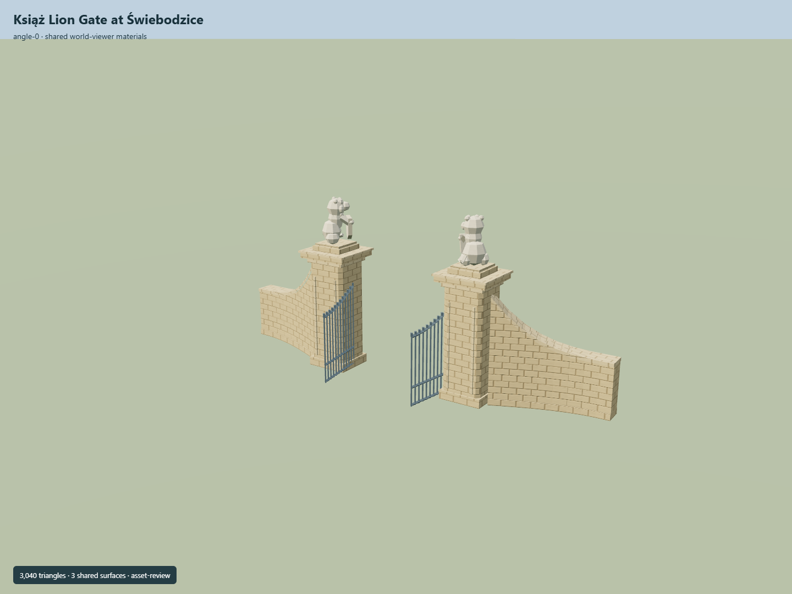

# Książ Lion Gate at Świebodzice

Pale sandstone piers with shield-bearing lions, curved terracotta wall panels, urn-topped outer posts and open wrought-iron leaves.

Independently placed component of [Książ Castle and park complex](../ksiaz_castle_and_park_complex/README.md). See the [placement review](QA-REVIEW.md) for the open approach and foundations.

## Sources and reconstruction

- [Reference](https://eli.gov.pl/api/acts/DU/2025/1089/text.pdf)
- [Reference](https://commons.wikimedia.org/wiki/File:PL,_%C5%9Awiebodzice_brama_do_parku_Ksi%C4%85%C5%BC_DSC_0008-001.JPG)
- [Reference](https://www.labiryntarium.pl/7gmin/gminaswiebodzice/698-spacerkiemdoksiaza.html)
- [Reference](https://www.openstreetmap.org/node/2618881852)

Original authored geometry under repository license. Mapped point/path controls © OpenStreetMap contributors,ODbL-1.0;linked research photographs are not redistributed.

The park-side photograph looks through the gate toward the mapped Wałbrzyska and Kasztanowa junction. The road-side photograph confirms the opposite approach and inward-facing lions. Foundations and wall plinths follow retained terrain, and the open leaves sit beside the path.

## Build

Run node content/worldgen/source/places/u3/u35/ksiaz-park-gates/models/generate-ksiaz-park-gates.mjs --ids=KSI_G03 (or --check).

6772 triangles;815568 source bytes;4 merged material groups;no embedded images. Shared coursed sandstone, raw sandstone carvings, lime plaster and painted metal use metric UVs and linear palette tints. Runtime LODs are separate generated outputs.

Source hash: sha256:b501748d3c88c4e7e5688c04b4860830ca83288184da194d3629678c924c9454
