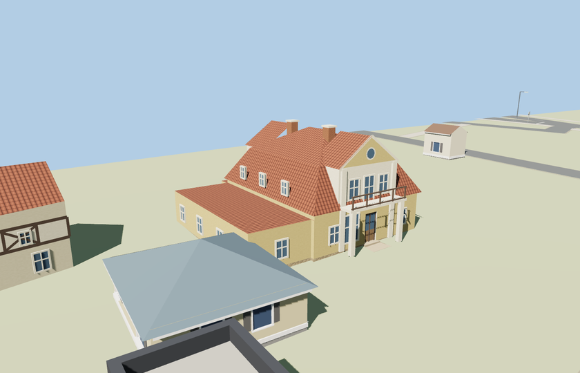

# Lubiechów Palm House administration

The east pediment, oculus, supported balcony and recessed glazed door follow the survey photographs. The tapered sandstone landing meets the yard.

The placement occupies its own mapped footprint. The foundation follows the terrain and the landing meets the sampled approach within 9 mm in all four detail levels.

In the joint Palm House fixture, a failed download restores this building’s own mapped fallback. The 13 independent buildings, 25 transportation records and water input remain. 100 placement probes passed.

| Detail level | Triangles | Download bytes | Draws |
| --- | ---: | ---: | ---: |
| skyline | 258 | 23,676 | 1 |
| district | 456 | 46,644 | 7 |
| street | 1,894 | 169,148 | 7 |
| closeup | 2,574 | 227,088 | 7 |

Skyline and district total 70,320 bytes. Six GLBs validated with zero errors or warnings. Reviewed 39 model views and 21 shared map views. Façade details and dimensions are interpretations of the historic exterior, with current restoration and interiors outside the review.

[Terrain controls](map-frame.json) · [Verification report](qa.json)
