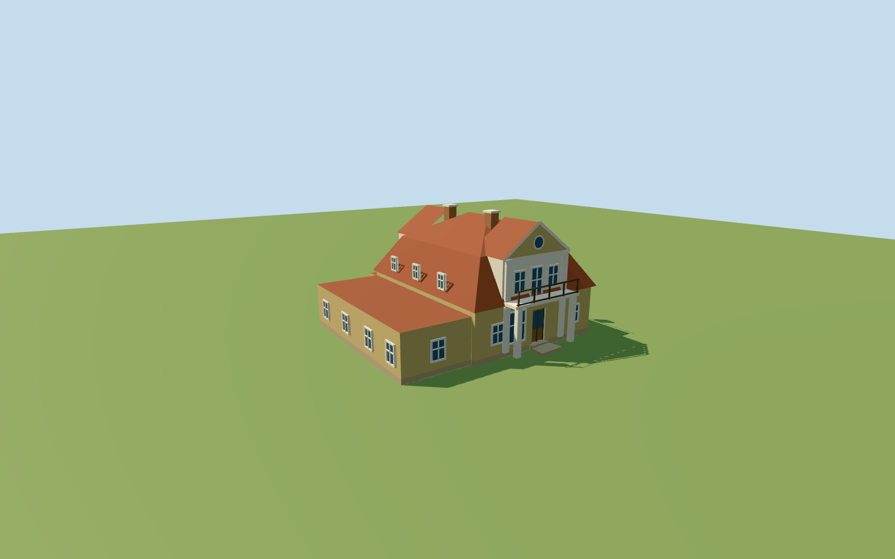

# Lubiechów Palm House administration

Own office outline with southern extension, broken hip roof, east oculus pediment and balcony, west arched pediment and pale pilasters.

Independent component of [Książ Castle and park complex](../ksiaz_castle_and_park_complex/README.md). See the [render and map review](QA-REVIEW.md).

## Sources and reconstruction

- [Reference](https://eli.gov.pl/api/acts/DU/2025/1089/text.pdf)
- [Reference](https://zabytek.pl/en/obiekty/g-259451)
- [Reference](https://zabytek.pl/en/obiekty/g-259451/dokumenty/PL.1.9.ZIPOZ.NID_N_02_EN.224651/1)
- [Reference](https://www.openstreetmap.org/way/263010003)

Original authored geometry under repository license. Mapped outline © OpenStreetMap contributors,ODbL-1.0;linked research photographs are not redistributed.

The own mapped footprint and historic façade orientation set the placement. The fitted plinth and recessed entrance use retained PMTiles terrain. Original exterior interpretation follows the individual NID cards and ensemble plan. Dimensions and present condition are estimates.

## Build

Run node content/worldgen/source/places/u3/u35/ksiaz-palm-services/models/generate-ksiaz-palm-services.mjs --ids=KSI_L02 (or --check).

2574 triangles;313048 source bytes;7 merged material groups. Six shared graphs for plaster, tile, rubble, sandstone, brick and timber use metric UVs and linear palette tints. Flat muted glazing adds one material. Runtime LODs are separate generated outputs.

Source hash: sha256:be3dfcd73817613c00259185819ad05c22ddd882fdf85acd8e87ad328cb1a1a4
