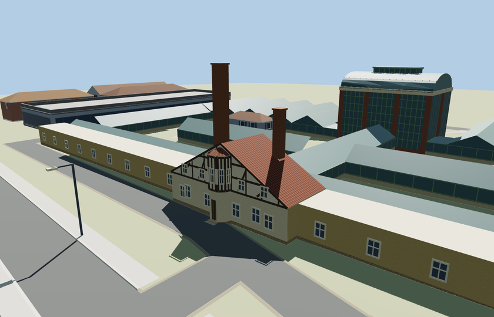

# Lubiechów Palm House boiler and north service range

The timbered half-round stair oriel and two square stacks interrupt the low service range. The oriel portal opens toward the mapped road and its step joins the rendered paving.

The placement occupies its own mapped footprint. The foundation follows the terrain and the landing meets the sampled approach within 13 mm in all four detail levels.

In the joint Palm House fixture, a failed download restores this building’s own mapped fallback. The 13 independent buildings, 25 transportation records and water input remain. 132 placement probes passed.

| Detail level | Triangles | Download bytes | Draws |
| --- | ---: | ---: | ---: |
| skyline | 291 | 26,212 | 1 |
| district | 471 | 47,480 | 7 |
| street | 3,011 | 263,952 | 7 |
| closeup | 4,271 | 371,312 | 7 |

Skyline and district total 73,692 bytes. Six GLBs validated with zero errors or warnings. Reviewed 39 model views and 21 shared map views. Façade details and dimensions are interpretations of the historic exterior, with current restoration and interiors outside the review.

[Terrain controls](map-frame.json) · [Verification report](qa.json)
