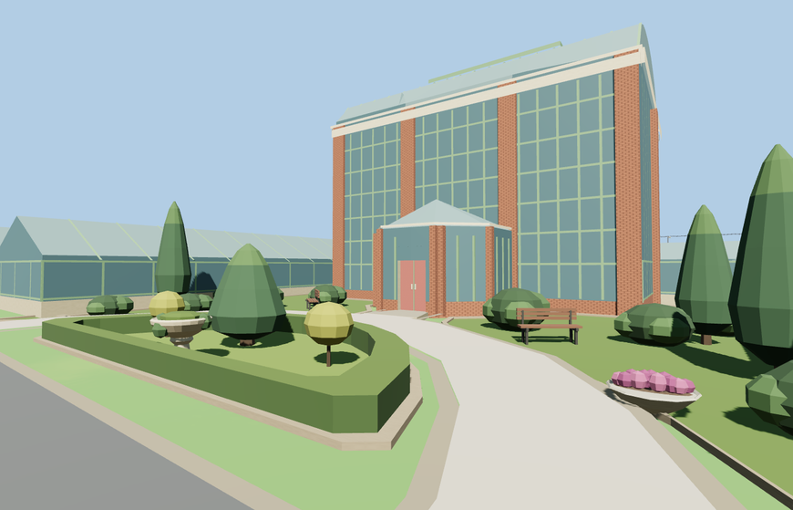

# Lubiechów Palm House entrance garden

Clipped yews and globes, two slatted benches, the stone urn and heather beds frame the Palm House entrance. The group fits the mapped lawns, and the plants read clearly beside the glasshouses.

Three lawns follow the rendered land-cover surface. Twenty-nine samples along the mapped loop and its entrance spur remained clear at each detail level.

The garden streams alongside the Palm House, west glasshouses and four service buildings. The fixture preserves 12 neighboring buildings, 25 transportation inputs and one water input. It passed 168 placement probes. In the failed-garden case, the mapped paths and land cover remain visible.

| Detail level | Triangles | Download bytes | Draws |
| --- | ---: | ---: | ---: |
| skyline | 909 | 76,840 | 1 |
| district | 2,886 | 254,796 | 5 |
| street | 5,344 | 467,060 | 5 |
| closeup | 7,624 | 658,732 | 5 |

The first two levels total 331,636 bytes. Six GLBs validated with zero errors or warnings. Reviewed 52 render views.

The operator photos establish the maintained forecourt. Individual plant sizes, species and fixture positions are visual interpretations.
This bundle covers the Palm House entrance lawns around the mapped loop. Former nursery plots and the wider estate park are separate scope.

[Mapped lawns and terrain controls](map-frame.json) · [Verification report](qa.json) · [Operator photos](https://www.ksiaz.walbrzych.pl/turystyka/palmiarnia)
