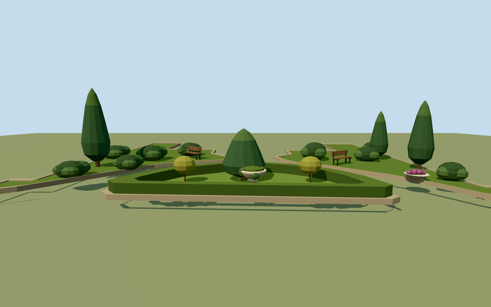

# Lubiechów Palm House entrance garden

Three planted lawns frame the loop to the Palm House. The clipped island hedge surrounds a conical yew, globe topiary, heather and a carved urn. Benches and low stone bowls sit along the side planting.

The operator photos establish the maintained forecourt. Individual plant sizes, species and fixture positions are visual interpretations.
This bundle covers the Palm House entrance lawns around the mapped loop. Former nursery plots and the wider estate park are separate scope.

The shared stone, wood, painted metal and gravel graphs use metric UVs. Clipped foliage and turf use palette colors.

Run node content/worldgen/source/places/u3/u35/ksiaz_palm_forecourt/models/generate-palm-forecourt.mjs to regenerate the model. Add --check to verify its source outputs.

[Placement review](QA-REVIEW.md) · [Operator gallery](https://www.ksiaz.walbrzych.pl/turystyka/palmiarnia)
