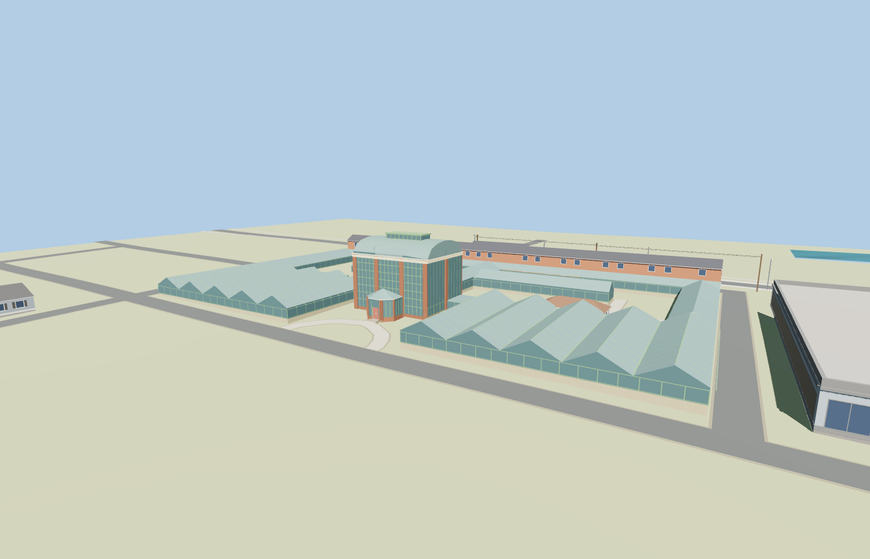

# Lubiechów Palm House

Brick piers and a cream cornice frame the green-tinted glass and barrel roof. The lantern reaches 15 m above the entrance datum. The polygonal porch has a recessed pair of doors and a sandstone landing. The surrounding roof bays follow both courtyard rings.

The modeled plinth sits on the sampled slope. The landing meets the rendered footway within 11 mm at the sampled points in all four detail levels. The occupied masks retain both open courts and replace the two mapped records for the building and its attached bay.

The 15 independent mapped buildings, 25 transportation records and water input remain in the fixture. A failed download restores both native building records. 460 geometry checks passed.

| Detail level | Triangles | Download bytes | Draws |
| --- | ---: | ---: | ---: |
| skyline | 926 | 72,140 | 1 |
| district | 3,886 | 337,128 | 5 |
| street | 5,628 | 488,960 | 5 |
| closeup | 5,808 | 505,880 | 5 |

Skyline and district total 409,268 bytes. Six GLBs validated with zero errors or warnings. Reviewed 39 model views and 12 native views. The photographs establish the exterior hall, porch and lantern. The low roof partitions, panes and entrance details are reconstructions. Tinted glass represents the exterior. Interior plants and the separate greenhouse ranges are outside this model.

[Placement and terrain controls](map-frame.json) · [Verification report](qa.json) · [Operator gallery](https://www.ksiaz.walbrzych.pl/turystyka/palmiarnia)
