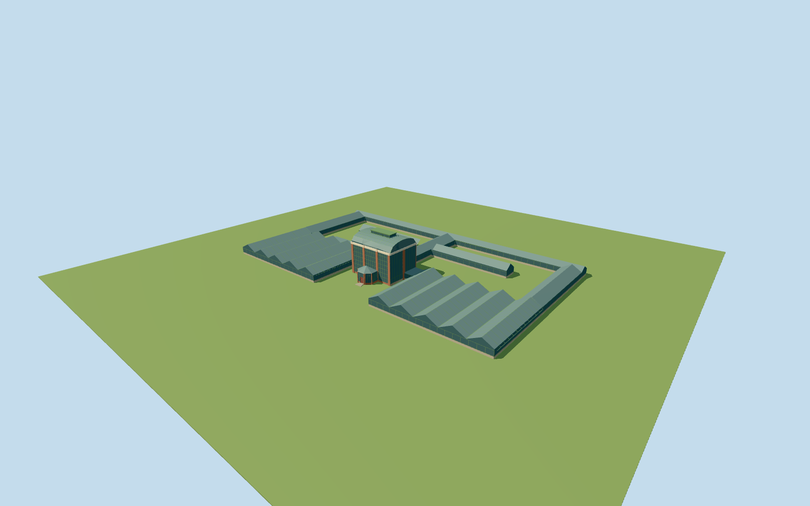

# Lubiechów Palm House

Tall brick-and-glass Palm House with green barrel roof, roof lantern and glazed polygonal porch; connected low glasshouse ranges enclose two true open courtyards.

Component of [Książ Castle and park complex](../ksiaz_castle_and_park_complex/README.md). See the [placement review](QA-REVIEW.md) for the terrain fit and viewer captures.

## Sources and reconstruction

- [Reference](https://eli.gov.pl/api/acts/DU/2025/1089/text.pdf)
- [Reference](https://www.ksiaz.walbrzych.pl/turystyka/palmiarnia)
- [Reference](https://www.openstreetmap.org/relation/3532583)

Original authored geometry under repository license. Mapped outline © OpenStreetMap contributors,ODbL-1.0;linked research photographs are not redistributed.

The single-storey glasshouses follow the mapped exterior and the two courtyard rings. Brick piers, the curved roof, lantern and porch follow the operator photographs. The lantern rises 15 m above the entrance datum. The fitted landing joins the mapped footway.

## Build

Run node content/worldgen/source/places/u3/u35/ksiaz_palm_house/models/generate-ksiaz-palm-house.mjs --ids=KSI_L01 (or --check).

5808 triangles, 700192 source bytes and 5 merged material groups. Brick, plaster, painted metal and sandstone use shared material graphs with metric UVs. The glass is tinted and all four runtime detail levels are generated separately.

Source hash: sha256:689a6fa74e31f6f6d01917cfa8d0df56e4e2c3e51eca2e2522b3888f99239463
