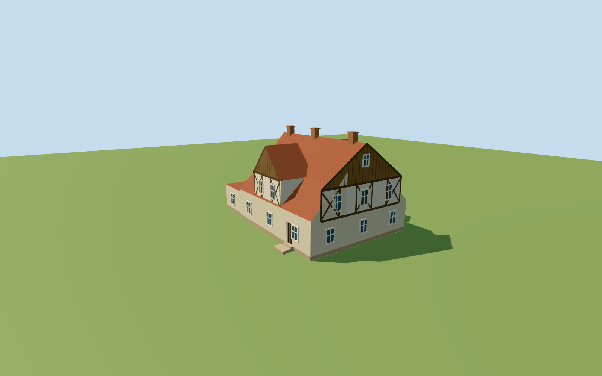

# Lubiechów Palm House residence

Own jogged residential footprint and west annex, broken red roof, timbered east gable and north/south cross-gables, stone base and three chimneys.

Independent component of [Książ Castle and park complex](../ksiaz_castle_and_park_complex/README.md). See the [render and map review](QA-REVIEW.md).

## Sources and reconstruction

- [Reference](https://eli.gov.pl/api/acts/DU/2025/1089/text.pdf)
- [Reference](https://zabytek.pl/en/obiekty/g-212551)
- [Reference](https://zabytek.pl/en/obiekty/g-212551/dokumenty/PL.1.9.ZIPOZ.NID_N_02_EN.224659/1)
- [Reference](https://www.openstreetmap.org/way/232185882)

Original authored geometry under repository license. Mapped outline © OpenStreetMap contributors,ODbL-1.0;linked research photographs are not redistributed.

The own mapped footprint and historic façade orientation set the placement. The fitted plinth and recessed entrance use retained PMTiles terrain. The west stair follows the elevation drawing and connects over the mapped low annex. Original exterior interpretation follows the individual NID cards and ensemble plan. Dimensions and present condition are estimates.

## Build

Run node content/worldgen/source/places/u3/u35/ksiaz-palm-services/models/generate-ksiaz-palm-services.mjs --ids=KSI_L04 (or --check).

2757 triangles;335008 source bytes;7 merged material groups. Six shared graphs for plaster, tile, rubble, sandstone, brick and timber use metric UVs and linear palette tints. Flat muted glazing adds one material. Runtime LODs are separate generated outputs.

Source hash: sha256:a3bba0f771b03c473c30a4ed84a4bc3b14006dcc35feba6db3fae0deb6e4df49
