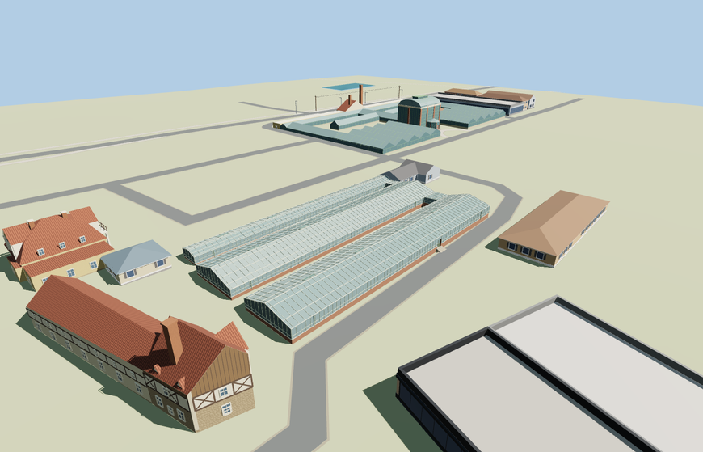

# Lubiechów Palm House west greenhouses

Three glazed ridges and an east connector fit the distinctive comb-shaped footprint. Pale frames, roof vents, a brick plinth and the recessed south entrance read correctly in the street views.

Both western slots stay open across four detail levels. The entrance apron meets the rendered service road within 9 mm at the sampled points.

The Palm House and four service models remain in place. A failed load restores the greenhouse’s mapped fallback. The joint fixture retains 12 independent mapped buildings, 25 transportation inputs and one water input. 424 placement probes passed.

| Detail level | Triangles | Download bytes | Draws |
| --- | ---: | ---: | ---: |
| skyline | 193 | 19,648 | 1 |
| district | 3,701 | 292,544 | 4 |
| street | 7,913 | 617,132 | 4 |
| closeup | 12,317 | 960,644 | 4 |

The first two levels total 312,192 bytes. Six GLBs validated with zero errors or warnings. Reviewed 51 renders. Historic aerial and eye-level photographs establish the low glazed ranges, pale sash, brick bases and surrounding open garden character. The precise current ridges, vents, doorway and construction dimensions of this separate western footprint are interpreted.

[Terrain controls](map-frame.json) · [Verification report](qa.json)
