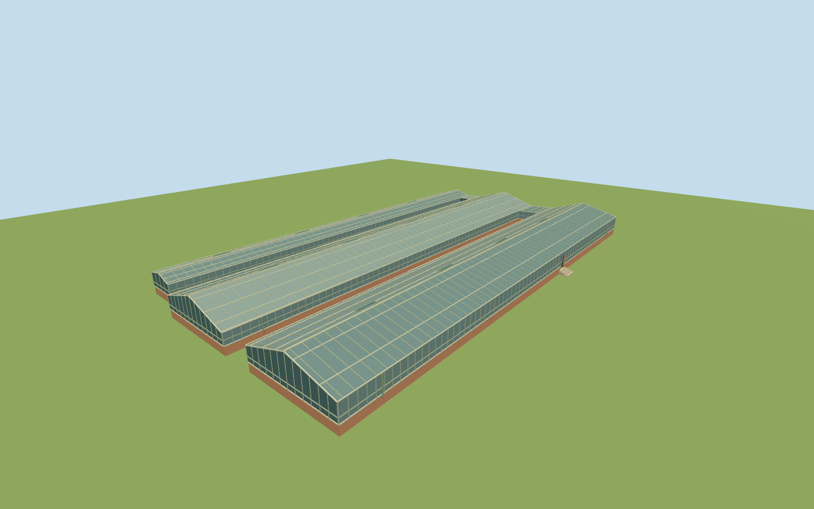

# Lubiechów Palm House west greenhouses

Three low glazed ranges share an east connector with two open western slots. Pale steel frames, raised ridge ventilators, a brick plinth and an inset south service door give each elevation depth.

The separate greenhouse uses its own PMTiles outline and east-west bay axis. Two open western slots are preserved. Terrain samples set the brick plinth and the south approach.

Historic aerial and eye-level photographs establish the low glazed ranges, pale sash, brick bases and surrounding open garden character. The precise current ridges, vents, doorway and construction dimensions of this separate western footprint are interpreted.
Exterior shell only. Former garden planting and interiors are outside this model.

The frame, brick and sandstone use the existing shared material graphs. The four detail levels preserve the roof and open bays. Tinted glass is opaque in the viewer.

Regenerate with `node content/worldgen/source/places/u3/u35/ksiaz_palm_west_greenhouses/models/generate-west-greenhouses.mjs`. Add `--check` to verify the generated files.

[Footprint](https://www.openstreetmap.org/way/263009991) · [1931 aerial photo](https://fotopolska.eu/2794063,walbrzych-ul-wroclawska-palmiarnia,zdjecie.html) · [1981 site photo](https://fotopolska.eu/669114,walbrzych-ul-wroclawska-palmiarnia,zdjecie.html) · [Placement review](QA-REVIEW.md)
