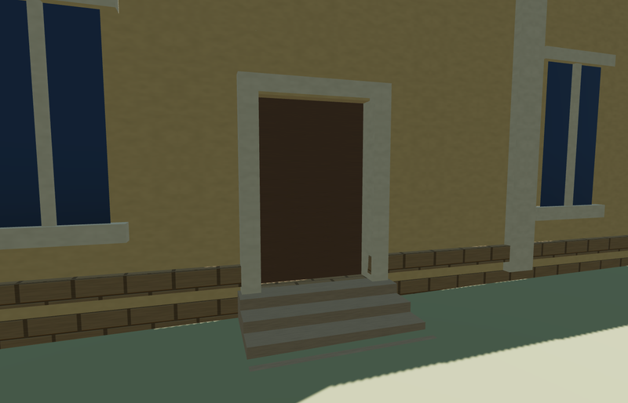

# Książ southern side wing

The wing has raised end pavilions, rounded dormer caps and closed roof returns. The courtyard entrance has a 24 cm recess and three solid sandstone treads.

The exact mapped wing faces the shared courtyard. Its original terrain sets the entrance datum. The apron meets the ground within 7 mm at three sampled points across all detail levels.

The three entrance buildings replace five mapped records. Along with the castle, they retain 14 neighboring buildings, 240 transportation inputs and four water inputs in the fixture. A forced north-wing load failure restores its mapped record. Unloading releases model geometry.

| Detail level | Triangles | Download bytes | Draws |
| --- | ---: | ---: | ---: |
| skyline | 215 | 21,548 | 1 |
| district | 459 | 46,720 | 6 |
| street | 2,337 | 207,352 | 6 |
| closeup | 2,927 | 260,860 | 6 |

Skyline and district total 68,268 bytes. Six GLBs passed Khronos validation. Inspected 39 model views and 13 shared site views. Roof heights, profiles, facade ornament, and stair dimensions are reconstruction estimates based on ordinary photographs and the retained map. The review covers the building exterior. The wider park and Palm House remain separate.

[Signed position and terrain controls](map-frame.json) · [Verification report](qa.json) · [Aerial reference](https://commons.wikimedia.org/wiki/File:Ksiaz_w_jesiennej_scenerii.jpg)
