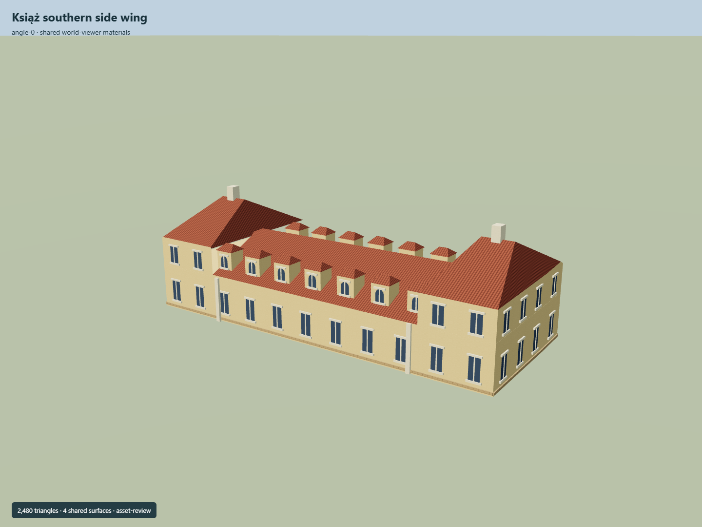

# Książ southern side wing

Pale yellow elongated side wing:lower central range with repeated dormers and raised two-floor end pavilions beneath red tile roofs.

Independently placed component of [Książ Castle and park complex](../ksiaz_castle_and_park_complex/README.md). See the [placement review](QA-REVIEW.md) for the ground fit.

## Sources and reconstruction

- [Reference](https://eli.gov.pl/api/acts/DU/2025/1089/text.pdf)
- [Reference](https://www.ksiazhotel.pl/hotel)
- [Reference](https://ksiazhotel.pl/pokoj-2os-komfort-oficyna)
- [Reference](https://commons.wikimedia.org/wiki/File:Ksiaz_w_jesiennej_scenerii.jpg)
- [Reference](https://www.openstreetmap.org/way/236837154)

Original authored geometry under repository license. Mapped outline © OpenStreetMap contributors,ODbL-1.0;linked research photographs are not redistributed.

The signed mapped ring and facing match the aerial and courtyard photographs. The standard retained Protomaps and Terrarium PMTiles locate the building and set an uncovered 398.98 m terrain contact. An inset sandstone footing follows the perimeter at the visualization datum. Three stone treads and a shallow apron join the recessed courtyard-side doorway to the original ground.

## Build

Run node content/worldgen/source/places/u3/u35/ksiaz-entrances/models/generate-ksiaz-entrances.mjs --ids=KSI_A03 (or --check).

2927 triangles;354952 source bytes;6 merged material groups;no embedded images. Shared plaster,tile,sandstone and gatehouse bronze use metric UVs and linear palette tints. Runtime LODs are separate generated outputs.

Source hash: sha256:2d936a891b49e59d642d0ac7815411adb277efd89d38d9fd0aa2b643667c673c
