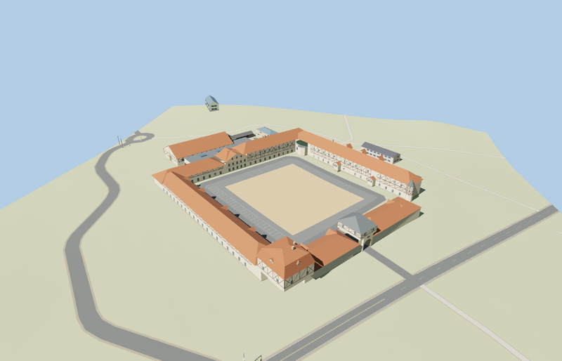

# Książ stable ensemble

The five stable ranges, carriage-house bays, gate and mansard towers enclose a sand riding court. A separate riding hall has a long gabled roof and lower annexes. Cream plaster, terracotta, slate, timber and limestone use the shared material library.

The structure fits the two mapped building outlines. The entrance arch follows the road into the court. It supplies the stone lining while the viewer draws the road at terrain grade. The inferred tunnel returns if the model fails to load.

All four levels replace the two mapped stable and hall footprints, retaining 11 independent buildings and 81 transportation records. 596 ground-contact probes, 960 arch-clearance traces, 20 sky traces and 24 court sampling checks passed.

| Detail level | Triangles | Download bytes | Draws |
| --- | ---: | ---: | ---: |
| skyline | 972 | 93,076 | 1 |
| district | 3,604 | 342,344 | 8 |
| street | 8,632 | 811,176 | 8 |
| closeup | 9,592 | 901,468 | 8 |

Skyline and district total 435,420 bytes. Six GLBs validated with zero errors or warnings. Reviewed 39 model views and 13 native views. The elevations, façade bays and internal range boundaries follow the plan and photographs. The model covers the exteriors, open gateway and riding court. Rooms and the surrounding grounds are outside this model.

[Placement and terrain controls](map-frame.json) · [Verification report](qa.json) · [Stable operator photographs](https://www.stadoksiaz.pl/zwiedzanie)
