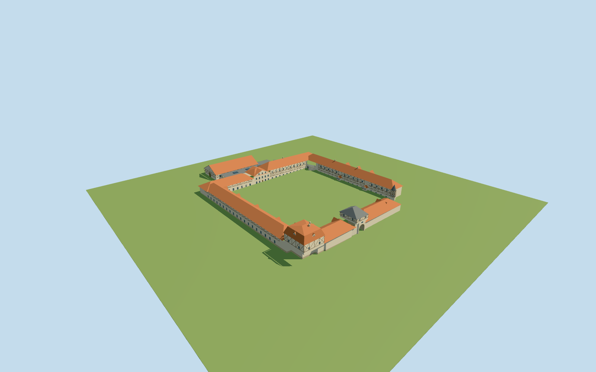

# Książ stable ensemble

Open stable quadrangle with five distinct ranges, arched gate tower, carriage-house bays, red mansard residence tower, cream administration gable, timber framing and the separate covered riding hall with connecting annexes.

Component of [Książ Castle and park complex](../ksiaz_castle_and_park_complex/README.md). See the [site review](QA-REVIEW.md) for the terrain fit and runtime views.

## Sources and reconstruction

- [Reference](https://eli.gov.pl/api/acts/DU/2025/1089/text.pdf)
- [Reference](https://pcbj.pl/wp-content/uploads/Stado-ogierow-Ksiaz-2005-Izabela-Rajca-Pisz.pdf)
- [Reference](https://www.stadoksiaz.pl/zwiedzanie)
- [Reference](https://www.openstreetmap.org/way/276970733)
- [Reference](https://www.openstreetmap.org/way/238999226)

Original authored geometry under repository license. Mapped outline © OpenStreetMap contributors,ODbL-1.0;linked research photographs are not redistributed.

Terrain sampled at the main gate sets the datum. The documentary plan and operator photos guide the roof profiles, part boundaries and façades.

## Build

Run node content/worldgen/source/places/u3/u35/ksiaz_stable_ensemble/models/generate-ksiaz-stables.mjs --ids=KSI_E01 (or --check).

9592 triangles, 1155636 source bytes;8 merged material groups;no embedded images. Six existing shared plaster, tile, slate, rubble, timber and limestone graphs use metric UVs and linear palette tints. Flat muted glazing adds one material. Open courtyard, secondary entrance and main through-passage retained. Runtime LODs are separate generated outputs.

Source hash: sha256:aa0efec83de66624215f650e36bfb09f060d132d9a50a8cfc976c6795f275463
