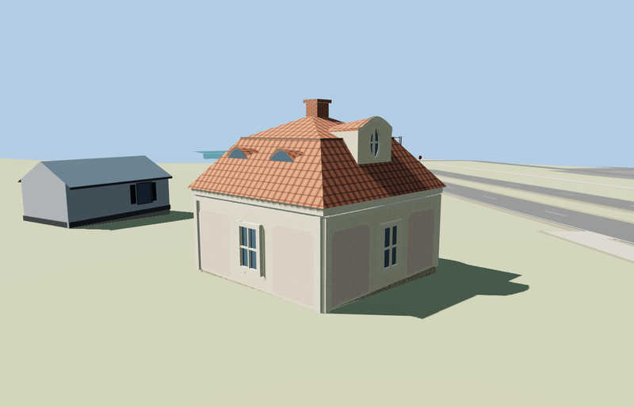

# Książ Swiss House I

Wałbrzyska 44 has the photographed oval dormer, paired eyebrow rooflights, blind plaster panels and a recessed side entrance. The tiled mansard meets the closed cornice.

The photograph beside Lion Gate places the paired eyebrows on the left roof slope and the oval dormer on the right. The side-door approach and stone steps follow the sampled slope. The stair toe joins the terrain within 3 mm at the sampled points across all four detail levels.

Both houses render with Lion Gate. Each replaces its own mapped footprint, preserving the other buildings and all 62 transportation inputs. A failed download restores that house’s procedural building while the other house and gate remain visible.

| Detail level | Triangles | Download bytes | Draws |
| --- | ---: | ---: | ---: |
| skyline | 206 | 18,936 | 1 |
| district | 298 | 32,828 | 7 |
| street | 974 | 86,528 | 7 |
| closeup | 1,114 | 98,456 | 7 |

Skyline and district total 51,764 bytes. Six GLBs validated with zero errors or warnings. Inspected 42 model views and 11 native views. The exterior follows the linked photographs. The stair profile, dimensions and unseen details are estimates. Neighboring buildings, parcel fences and interiors remain outside this model.

[Placement and terrain controls](map-frame.json) · [Verification report](qa.json) · [Trail photographs](https://www.labiryntarium.pl/7gmin/gminaswiebodzice/698-spacerkiemdoksiaza.html)
