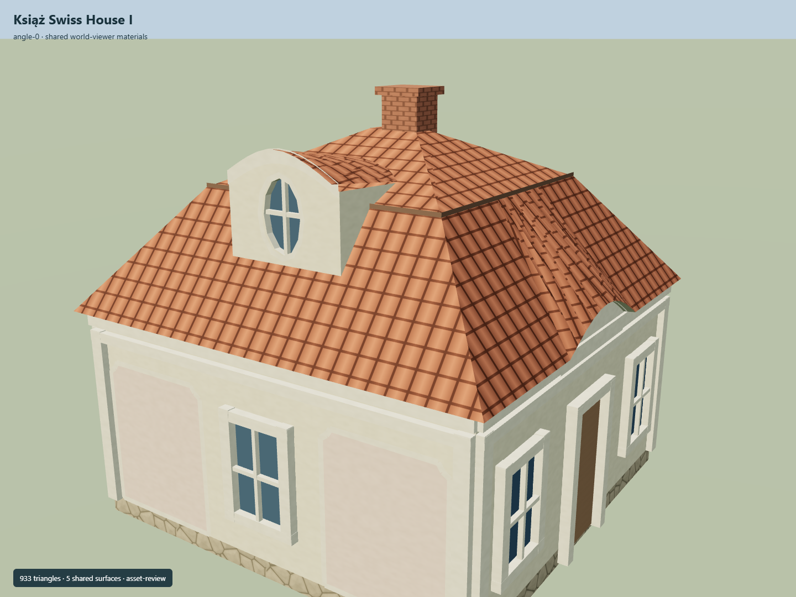

# Książ Swiss House I

Cream plaster pavilion with pink blind panels, tiled mansard, oval dormer and paired side rooflights. A recessed door leads to a short stone landing.

Independent component of [Książ Castle and park complex](../ksiaz_castle_and_park_complex/README.md). The [placement review](QA-REVIEW.md) shows the approach and fitted exterior.

## Sources and reconstruction

- [Reference](https://eli.gov.pl/api/acts/DU/2025/1089/text.pdf)
- [Reference](https://zabytek.pl/pl/obiekty/g-240579)
- [Reference](https://commons.wikimedia.org/wiki/File:PL,_%C5%9Awiebodzice_dom_szwajcarski_44_DSC_0015.JPG)
- [Reference](https://www.labiryntarium.pl/7gmin/gminaswiebodzice/698-spacerkiemdoksiaza.html)
- [Reference](https://www.openstreetmap.org/way/255269521)

Original authored geometry under repository license. Mapped outline © OpenStreetMap contributors,ODbL-1.0;linked research photographs are not redistributed.

The oval dormer and two smaller lights face the sides visible from Lion Gate. The opposite side portal has a recessed door and a short landing that follows the sampled terrain. Heights and unseen details are photographic estimates.

## Build

Run node content/worldgen/source/places/u3/u35/ksiaz-swiss-houses/models/generate-ksiaz-swiss-houses.mjs --ids=KSI_S02 (or --check).

1114 triangles;137824 source bytes;7 merged material groups with shared plaster, tile, rubble, sandstone, brick and timber. Flat muted glazing adds one material. Four runtime levels are generated from the same recipe.

Source hash: sha256:7560415b8e92faa5d5923ea2de987d15111807aacfa8d22fda1102d95952c0a7
