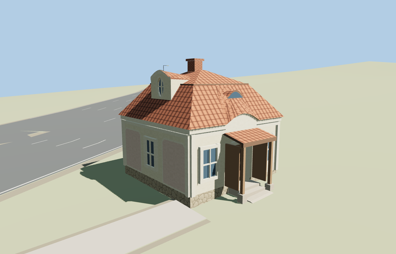

# Książ Swiss House II

Wałbrzyska 46 has the photographed oval dormer, eyebrow rooflight and timber porch with a recessed door. The tiled mansard meets the closed cornice above the plaster facade.

The photograph beside Lion Gate places the oval dormer on the left roof slope and the eyebrow and porch on the gate-facing slope. The porch posts and foundation meet the sampled slope. The stair toe joins the terrain within 3 mm at the sampled points across all four detail levels.

Both houses render with Lion Gate. Each replaces its own mapped footprint, preserving the other buildings and all 62 transportation inputs. A failed download restores that house’s procedural building while the other house and gate remain visible.

| Detail level | Triangles | Download bytes | Draws |
| --- | ---: | ---: | ---: |
| skyline | 264 | 23,892 | 1 |
| district | 339 | 36,160 | 7 |
| street | 1,003 | 89,628 | 7 |
| closeup | 1,143 | 101,556 | 7 |

Skyline and district total 60,052 bytes. Six GLBs validated with zero errors or warnings. Inspected 39 model views and 11 native views. The exterior follows the linked photographs. The stair profile, dimensions and unseen details are estimates. Neighboring buildings, parcel fences and interiors remain outside this model.

[Placement and terrain controls](map-frame.json) · [Verification report](qa.json) · [Trail photographs](https://www.labiryntarium.pl/7gmin/gminaswiebodzice/698-spacerkiemdoksiaza.html)
