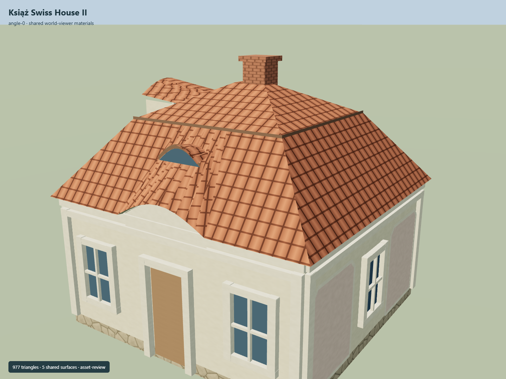

# Książ Swiss House II

Cream plaster pavilion with pink blind panels, tiled mansard, road-facing oval dormer, eyebrow rooflight and a timber porch over the gate-side entrance.

Independent component of [Książ Castle and park complex](../ksiaz_castle_and_park_complex/README.md). The [placement review](QA-REVIEW.md) shows the approach and fitted exterior.

## Sources and reconstruction

- [Reference](https://eli.gov.pl/api/acts/DU/2025/1089/text.pdf)
- [Reference](https://zabytek.pl/pl/obiekty/g-221860)
- [Reference](https://commons.wikimedia.org/wiki/File:PL,_%C5%9Awiebodzice_dom_szwajcarski_46_DSC_0017.JPG)
- [Reference](https://www.labiryntarium.pl/7gmin/gminaswiebodzice/698-spacerkiemdoksiaza.html)
- [Reference](https://www.openstreetmap.org/way/255269530)

Original authored geometry under repository license. Mapped outline © OpenStreetMap contributors,ODbL-1.0;linked research photographs are not redistributed.

The road-facing oval dormer and gate-facing eyebrow rooflight set the two signed facades. A short sheltered landing fits the sampled terrain beside the gate-facing door. Heights and unseen details are photographic estimates.

## Build

Run node content/worldgen/source/places/u3/u35/ksiaz-swiss-houses/models/generate-ksiaz-swiss-houses.mjs --ids=KSI_S03 (or --check).

1143 triangles;141308 source bytes;7 merged material groups with shared plaster, tile, rubble, sandstone, brick and timber. Flat muted glazing adds one material. Four runtime levels are generated from the same recipe.

Source hash: sha256:a770ea182bb685e53d0c89678ee2e987c4481ab531a5bf0e4e87d2a8922c4664
