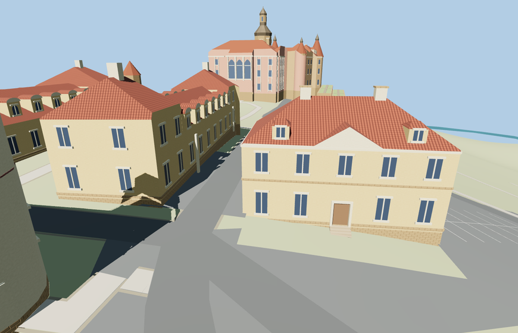

# Hotel Zamkowy at Książ

The former tax office has cream walls, a sandstone floor band, a red hip roof and a shallow cross gable above the main façade. Two low dormers and paired chimneys complete the photographed roofline.

The mapped building sits on a fitted plinth. Three treads lead up to the recessed forecourt entrance. At the sampled points, the landing meets the terrain within 8 mm at all four detail levels.

The castle, gatehouse and both wings load alongside the hotel. The viewer retains all 13 other buildings, 240 transportation records and four water inputs in the fixture. When the hotel request fails, its mapped footprint returns. 116 geometry checks passed.

| Detail level | Triangles | Download bytes | Draws |
| --- | ---: | ---: | ---: |
| skyline | 186 | 18,960 | 1 |
| district | 302 | 34,892 | 6 |
| street | 1,100 | 106,160 | 6 |
| closeup | 1,430 | 135,884 | 6 |

Skyline and district total 53,852 bytes. Six GLBs validated with zero errors or warnings. Reviewed 39 model views and 12 native views. The aerials establish the building, frontage and roof shape. The door, treads and rear façade details are reconstructions. The scope covers the exterior.

[Placement and terrain controls](map-frame.json) · [Verification report](qa.json) · [National Heritage Institute entry](https://zabytek.pl/en/obiekty/g-278127) · [Labeled aerial](https://i.szalas.hu/hotels/1554425/500x500/40603663.jpg)
