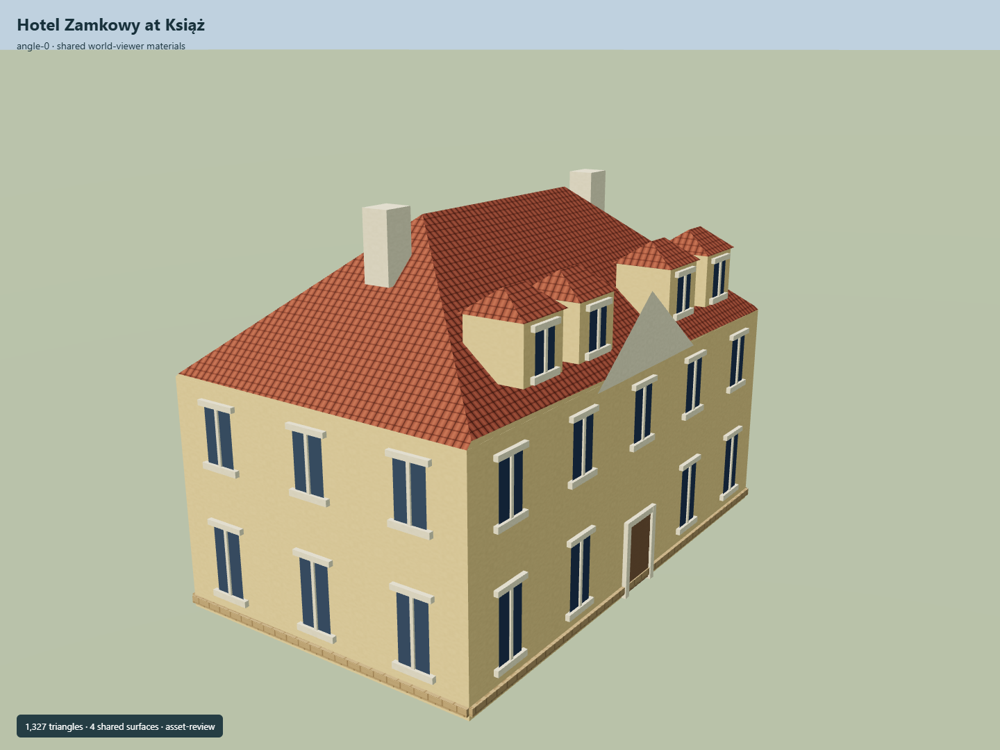

# Hotel Zamkowy at Książ

Detached cream hotel with a red hip roof, a joined cross gable, two low dormers and a recessed forecourt entrance.

Independently placed component of [Książ Castle and park complex](../ksiaz_castle_and_park_complex/README.md). See the [placement review](QA-REVIEW.md) for the ground fit.

## Sources and reconstruction

- [Reference](https://zabytek.pl/en/obiekty/g-278127)
- [Reference](https://i.szalas.hu/hotels/1554425/500x500/40603663.jpg)
- [Reference](https://www.zamek-ksiaz-hotel-przy-oslej-bramie.pl/img/_img81.jpg)
- [Reference](https://www.openstreetmap.org/way/236837151)

Original authored geometry under repository license. Mapped outline © OpenStreetMap contributors,ODbL-1.0;linked research photographs are not redistributed.

The east-facing gable follows the photographed orientation. The sandstone plinth meets the retained PMTiles terrain and a reconstructed recessed entrance and landing join the forecourt grade.

## Build

Run node content/worldgen/source/places/u3/u35/ksiaz-entrances/models/generate-ksiaz-entrances.mjs --ids=KSI_A04 (or --check).

1430 triangles;175304 source bytes;6 merged material groups;no embedded images. Shared plaster,tile,sandstone and gatehouse bronze use metric UVs and linear palette tints. Runtime LODs are separate generated outputs.

Source hash: sha256:6c9b9fb2cbfac489ed72d32a47d07a22bbd02f339ff25d53161789e44dbed6f6
