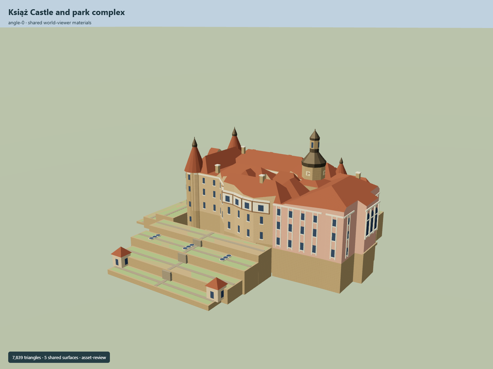

# Książ Castle and park complex

Castle/terrace core:coral-pink Baroque entrance wing,tall domed central lantern tower,paired western steep red roof towers,buff neoRenaissance stone ranges,open courts,half-timber gallery and stepped gardens. Wider heritage ensemble remains incomplete.

## Evidence and reconstruction

Published dimensions and reconstructed details are separated in spec.json. Primary references:

- [Reference](https://www.ksiaz.walbrzych.pl/en/turystyka/zamek)
- [Reference](https://www.ksiaz.walbrzych.pl/en/turystyka/aktualnosci/bajkowy-ogrod-na-skale-czyli-tarasy-zamku)
- [Reference](https://eli.gov.pl/api/acts/DU/2025/1089/text.pdf)
- [Reference](https://architectus.pwr.edu.pl/files/numery/82_01.pdf)
- [Reference](https://www.ksiaz.walbrzych.pl/data/dokumenty/without_car.pdf)
- [Reference](https://commons.wikimedia.org/wiki/File:Ksiaz_w_jesiennej_scenerii.jpg)
- [Reference](https://commons.wikimedia.org/wiki/File:Zamek_ksi%C4%85%C5%BC.jpg)
- [Reference](https://www.openstreetmap.org/relation/9821066)

Mapped castle/court rings reproduce attributed OSM data underODbL. Other geometry is original approximate authoring. Research photographs/maps remain private evidence;no downloaded geometry or unique textures embedded.

## Model and axes

7,839 triangles; 23,517 vertices; 7 material groups; 944,752 bytes. Native bounds: -79.000, -16.166, -55.000 to 93.078, 52.000, 69.000. Source hash: `sha256:1a72f7525190785b18f4e481506f4eac6fd4ff2c5a5a471fb320314e49d0c07a`.

{"up":"+Y","lateral":"+X approximately east-north-east;Baroque entrance faces +X","longitudinal":"+Z approximately south-south-east","origin":"Site anchor; Y0 standard PMTiles working datum."}

Inspected aerial picture confirms coral-pink Baroque entrance wing, tall domed central tower, paired western roof towers, buff stone ranges and stepped garden terraces. Retained mapped castle/court rings and standard viewer PMTiles set approximate location, scale and entrance-facing orientation. The derivative reconstructs a working court at Y5, keeps terrace tops above coarse ground and moves the separate Powder Tower to its retained mapped position at native [88.89756493084487,47.64031319972397] with a coarse-ground footing. This review covers the castle/terrace model; separately modeled park buildings retain their own QA status. Anchor 16.291558848,50.842218729; heading 0.487948990682; standard PMTiles datum 392.7276846126304m. Floors are reconstructed and foundations extend below the coarse sampled ground.

## Reproduce

Run `node packages/worldgen/scripts/generate-signature-towers.mjs --ids=N0291` (or add `--check`). The generator preserves manually edited masters by checking their baseline hashes. Import through the standard authored-model workflow with optimization disabled; then capture all QA cameras, including shared-surface views.

## Pending work

- Approximate current castle/terrace exterior from one inspected picture and standard viewer PMTiles, without bespoke survey or exact thresholds.
- Original detailed master/hash/recipe preserved. Court, terraces, roof and tower dimensions remain reconstructed; separate Powder Tower control follows retained map location with approximate body/roof dimensions.
- Five common graphs plus explicit garden-color and dark recess slots, zero embedded images. Forest, exact terrace planting/water, interiors and terrain cutouts excluded.
- Castle/terrace model review does not approve the complete designated heritage ensemble, remote Palm House or separately modeled park buildings. Their individual reviews remain independent.
- Footprint replacement remains off; physical-device timing unmeasured.

This bundle follows the medium-fi standard. Medium-fi appearance and geographic fit are reviewed separately. Hash-bound visual acceptance is recorded separately after capture inspection.

## Additional geographic data

© OpenStreetMap contributors;Książ Castle operator;Polish official heritage designation;Chorowska/Mruczek;primary photographers.
