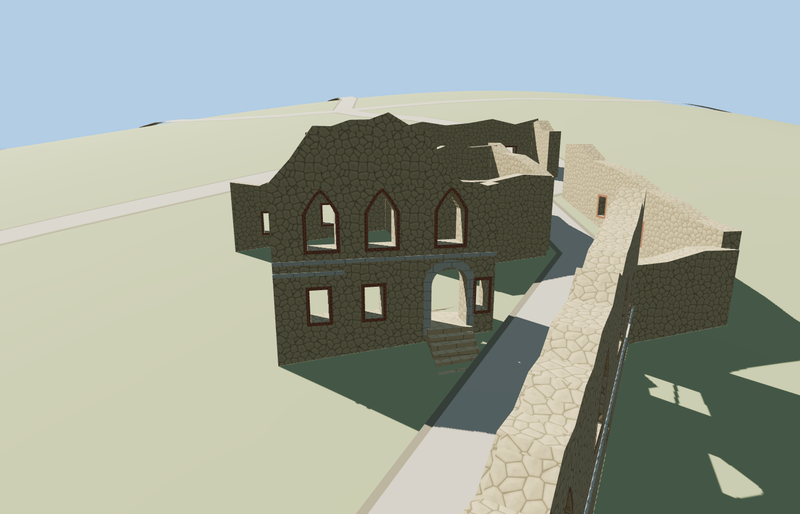

# Old Książ ruins

The surviving walls follow their four mapped traces. The high wall has a dressed limestone portal and three open pointed windows. The broken gallery, brick-lined reveals and low return walls leave the courtyards open to the sky.

The portal opens toward the lower approach. Five stone steps and the upper landing meet the retained terrain within 4 mm at the sampled points in all four detail levels. The trail crosses a fitted breach in the uphill return wall.

All four levels preserve the 41 mapped transportation records and the river in the fixture. 136 foundation probes, 288 trail-clearance traces, 85 opening traces and 24 sky traces passed. A failed model load leaves the retained terrain and trail available.

| Detail level | Triangles | Download bytes | Draws |
| --- | ---: | ---: | ---: |
| skyline | 864 | 58,568 | 1 |
| district | 1,592 | 101,472 | 3 |
| street | 2,452 | 152,372 | 3 |
| closeup | 2,998 | 183,588 | 3 |

Skyline and district total 160,040 bytes. Six GLBs validated with zero errors or warnings. Inspected 39 model views and 13 native views. Wall heights, opening dimensions and stair profiles follow the photographs and local terrain samples. The trail and cliff keep the host terrain. The surrounding trees, underground remains and earlier phases of the castle are outside this model.

[Placement and terrain controls](map-frame.json) · [Verification report](qa.json) · [Municipal photographs](https://cit.walbrzych.pl/miejsce/stary-ksiaz/)
