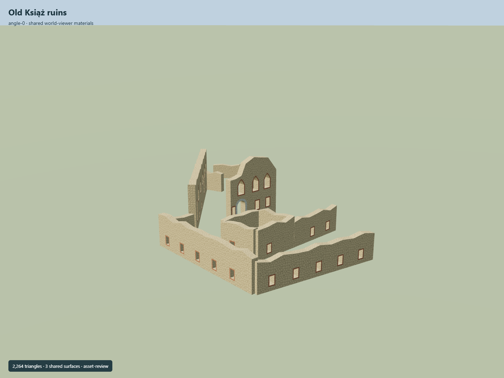

# Old Książ ruins

Roofless masonry ruins with Gothic window openings, a dressed-stone portal and stairs, and a trail breach through the hillside return wall.

Independent component of [Książ Castle and park complex](../ksiaz_castle_and_park_complex/README.md). The [placement review](QA-REVIEW.md) records the hillside fit and open approaches.

## Sources and reconstruction

- [Reference](https://eli.gov.pl/api/acts/DU/2025/1089/text.pdf)
- [Reference](https://www.ksiaz.walbrzych.pl/turystyka/zamek)
- [Reference](https://commons.wikimedia.org/wiki/File:Old_Ksi%C4%85%C5%BC_Castle_02.JPG)
- [Reference](https://commons.wikimedia.org/wiki/File:Stary_Ksi%C4%85%C5%BC_8.jpg)
- [Reference](https://cit.walbrzych.pl/miejsce/stary-ksiaz/)
- [Reference](https://www.openstreetmap.org/way/239074431)

Original authored geometry under repository license. Mapped outline © OpenStreetMap contributors,ODbL-1.0;linked research photographs are not redistributed.

The dressed portal faces the downslope approach, with the pointed gallery along the long wall tracing the ravine side. Individual footings follow the retained terrain. The fitted stairs and upper landing join both sides of the portal, and a gap retains the mapped trail through the return wall. Wall dimensions and stair profiles are visualization estimates.

## Build

Run node content/worldgen/source/places/u3/u35/old_ksiaz_ruins/models/generate-old-ksiaz.mjs --ids=KSI_R01 (or --check).

2998 triangles;362180 source bytes;3 merged material groups;no embedded images. Three existing shared rubble, brick and limestone graphs use metric UVs and linear palette tints. Openings are real through-holes, not opaque panes. No roof or terrain fill is generated. Runtime LODs are separate generated outputs.

Source hash: sha256:ad845625a37f67825116a16b0036f152d5ce1f820d346591b5bc3df26f07696d
