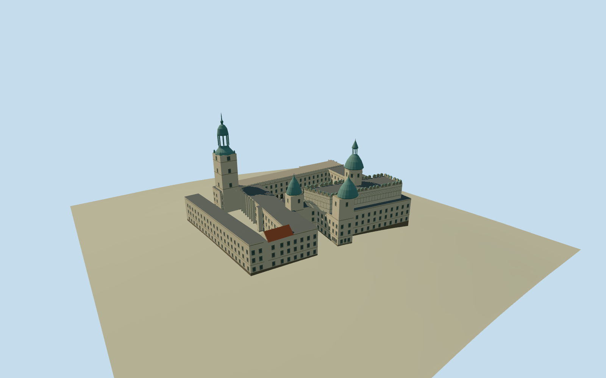

# Ducal Castle, Szczecin

Pomeranian Dukes’ Castle in Szczecin, with both courtyards, the raised Renaissance attic, green copper towers and astronomical clock.

Authoring state: **review-in-qa.json**. Current completion evidence is in [qa.json](qa.json) and the [completion ledger](../../../../qualla-structures/batches/qualla-004.PROGRESS.md).

- [Ducal Castle, Szczecin](https://qualla.com/ducal-castle-szczecin/)

The native map fixes the compound plan and varied courtyard levels. The documented Bell Tower height controls the highest point. Other roof and tower heights, lower arcades on less visible sides and fine relief use reference proportions.

Build: `node content/worldgen/source/places/u3/u36/ducal_castle_szczecin/models/generate-ducal-castle-szczecin.mjs`. Add `--check` to verify exact regeneration. 33712 triangles; 8 materials; no embedded photographs.
