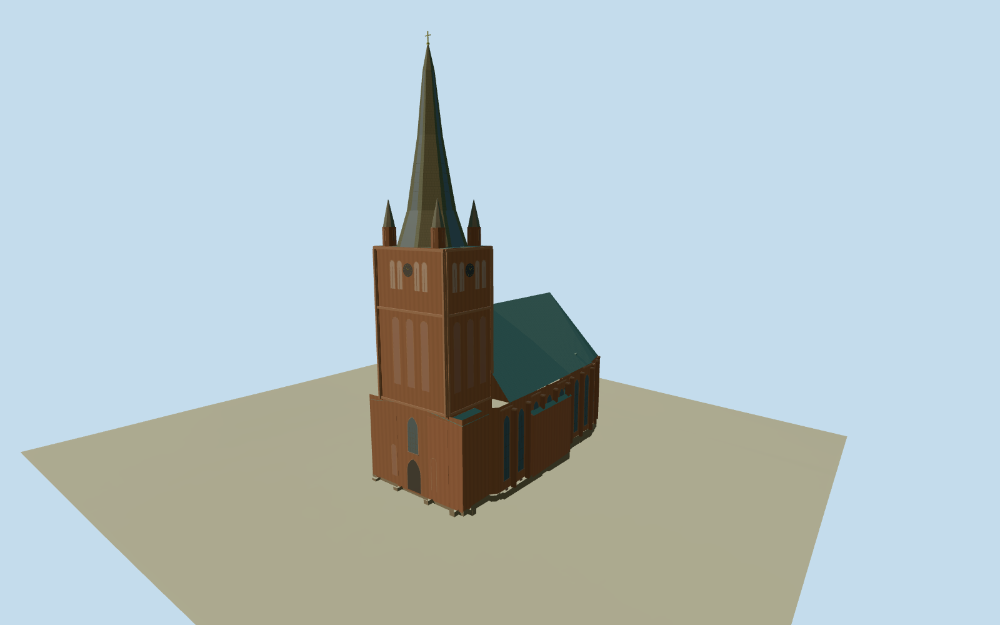

# Szczecin Cathedral

Szczecin’s great Brick Gothic cathedral, with a polygonal east choir, broad copper-green roof and the restored copper spire above the west tower.

Authoring state: **review-in-qa.json**. Current completion evidence is in [qa.json](qa.json) and the [completion ledger](../../../../qualla-structures/batches/qualla-004.PROGRESS.md).

- [Szczecin Cathedral](https://qualla.com/szczecin-cathedral/)

The present church and restored west spire are modeled. Separate nearby houses and stained-glass interiors are outside the scope.

The original and restored tower features, broad green roof and wall alignments are grounded in the photos and mapped building. Fine masonry patterns and chapel roofs are representative.

The open elevation field resolves the general street slope only; exact curb heights are below its source resolution.

Build: `node content/worldgen/source/places/u3/u36/szczecin_cathedral/models/generate-szczecin-cathedral.mjs`. Add `--check` to verify exact regeneration. 6437 triangles; 6 materials; no embedded photographs.
