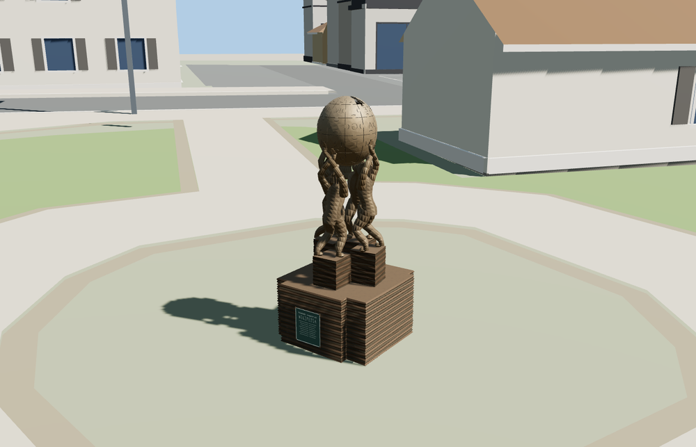

# Wikipedia Monument

Four bronze figures lift a hollow jigsaw globe above layered stacks of pages. The plinth has the green plaque, and the globe includes cutouts at the crown, carved seams and characters from several scripts.

Named OSM artwork node 3144422008 sets the terrain-relative placement. The plaque faces southeast based on the photographed neighboring hipped-roof building. The estimated bearing has about 30° of uncertainty. The surrounding buildings, terrain and paths remain native when the monument loads or unloads.

The 50,256-triangle source rebuilds byte for byte. The first two runtime tiers total 446,420 bytes. Six GLBs validated and 36 current views were inspected.

The named PMTiles artwork point anchors the monument. The southeast plaque bearing is a photo estimate with about 30° of uncertainty. The bronze poses, puzzle seams, multilingual marks and layered pages are modeled from exterior photos. Fine lettering and facial details are simplified. The surrounding shelter belongs to the square.

Rebuild with `node packages/worldgen/scripts/generate-wikipedia-monument.mjs`. Append `--check` to compare exact bytes. Use `--ids=wikipedia_monument` for targeted import, LOD, placement and readiness.
