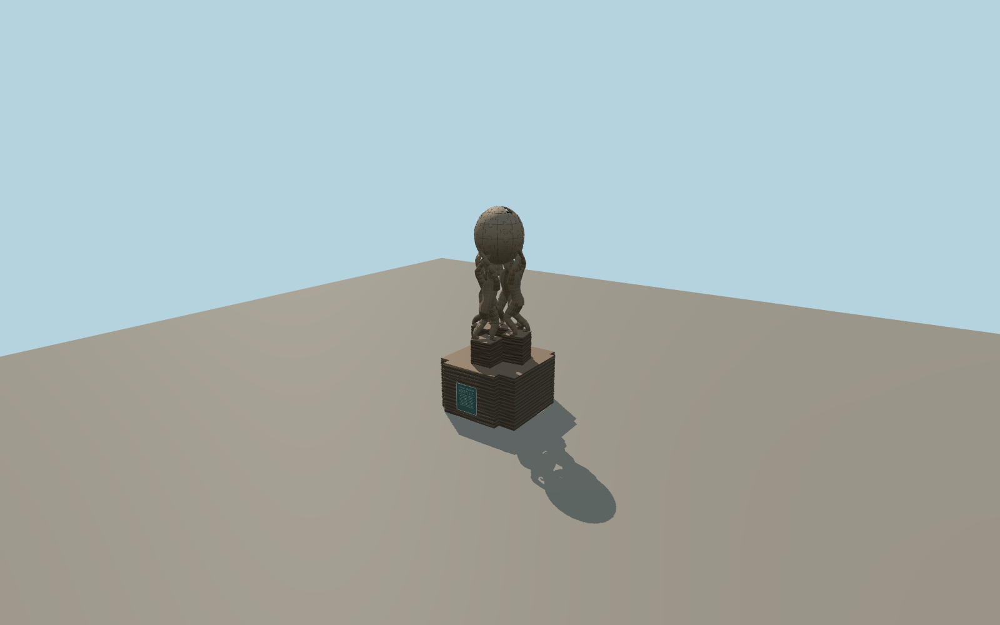

# Wikipedia Monument

Four bronze figures lift a hollow jigsaw globe above layered stacks of pages. The plinth has the green plaque, and the globe includes cutouts at the crown, carved seams and characters from several scripts.

Run `node packages/worldgen/scripts/generate-wikipedia-monument.mjs` to rebuild the source master. Append `--check` to compare the exact bytes. Use `--ids=wikipedia_monument` for targeted import, LOD generation and placement.

The named PMTiles artwork point anchors the monument. The southeast plaque bearing is a photo estimate with about 30° of uncertainty.

The bronze poses, puzzle seams, multilingual marks and layered pages are modeled from exterior photos. Fine lettering and facial details are simplified. The surrounding shelter belongs to the square.

Original geometry follows the repository license. Map data is © OpenStreetMap contributors under ODbL-1.0 via Protomaps. Terrain samples are described in terrain-grid.json. Ordinary pictures stay local and are not redistributed or used as textures. Current acceptance is recorded in qa.json.
