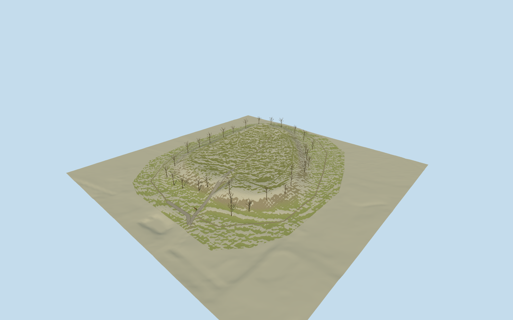

# Mecklenburg Castle

The surviving oval Burg Mecklenburg bank and ditch with the present northern entrance.

Authoring state: **review-in-qa.json**. Current completion evidence is in [qa.json](qa.json) and the [completion ledger](../../../../qualla-structures/batches/qualla-004.PROGRESS.md).

- [Mecklenburg Castle](https://qualla.com/mecklenburg-castle/)

Planting is a representative sparse grove that preserves the visible surviving earthwork. Individual trees, monuments and graves are not surveyed.

The paved widths and entrance furnishings are approximate. The historic lost timber or masonry superstructure is not reconstructed.

Build: `node content/worldgen/source/places/u3/u38/mecklenburg_castle/models/generate-mecklenburg-castle.mjs`. Add `--check` to verify exact regeneration. 37672 triangles; 5 materials; no embedded photographs.
