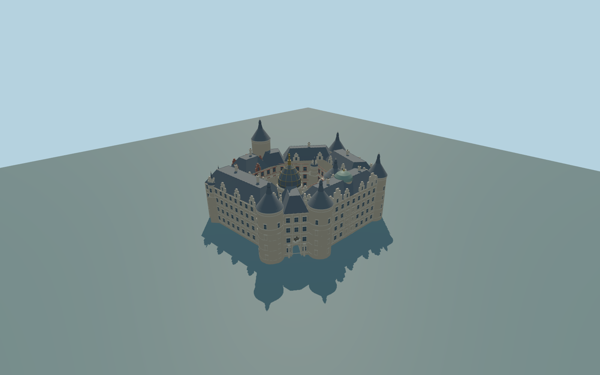

# Schwerin Castle

Complete principal irregular castle ring with its actual open courtyard,main entrance passage,gilded courtyard-side dome,green west dome,four tall outer round towers,two court turrets,northeastern chapel/bay,stepped roof gables and chimney silhouettes. Independent lower orangery and island terrace/bridge/garden structures remain native context.

Rebuild: `node packages/worldgen/scripts/generate-schwerin-castle.mjs`;append `--check` for exact source bytes. Select import/LOD/placement with `--ids=schwerin_castle`. Detailed source and four browser tiers are separate ignored GLB outputs.

Complete principal irregular castle ring with its actual open courtyard,main entrance passage,gilded courtyard-side dome,green west dome,four tall outer round towers,two court turrets,northeastern chapel/bay,stepped roof gables and chimney silhouettes. Independent lower orangery and island terrace/bridge/garden structures remain native context.

Retained irregular exterior/court rings are real void geometry;no convex parent fill. Seven distinct range roofs with opaque caps,open arched through passage,individual radial tower profiles andtwo distinctive domes. Source has denser profiles/frames/stepped gables;tiers remove small trim/windows before skyline volumes.

Approximate47m sea-level datum from unmodified standard129x129/2m global viewer field. Exterior foundations sample field-.35m;entrance floor follows field+.12m. Original photo-proportional main eaves23.6-25.2m/roofs31-33m;outer towers~42m,great garden tower~52m,gilded dome figure~49m. Native height tags inform silhouettes but are not surveyed. No island flattening.

Ordinary pictures plus standard PMTiles/global terrain only. Fine window/gable/chimney/sculpture inventories,roof junctions,exact foundations/historic threshold/accessibility levels approximate. Original simplified figure/equestrian silhouettes do not copy sculpture or lettering. Closed panes/doors exclude optical interiors. Independent orangery,bridges,terrace/garden retaining walls and island landscaping excluded and preserved. No private/embedded images. Physical laptop/phone/dense-city timing unmeasured.

Seven existing256px shared sandstone,limestone,brick,slate,painted-metal,window-grid andpainted-wood graphs;metric UVs/linear colors. Skyline preserves the principal open court,gate,tall towers andtwo contrasting domes without small windows. District keeps sparse glazing andselected gables;street adds flat frames andnine turret silhouettes;close-up has physical border frames anddenser tower/gable profiles;master keeps finer mullions/profiles andmore gables. Subpixel small court/chapel turrets omitted from skyline/district. Error estimates4/2/1/.3m are not measured mesh distances. No physical device timing.

Original geometry:repository license. Map:© OpenStreetMap contributors,ODbL-1.0;Protomaps. Standard terrain:terrain-grid.json. Ordinary pictures stay local and are not redistributed or used as textures. Current acceptance:qa.json.
