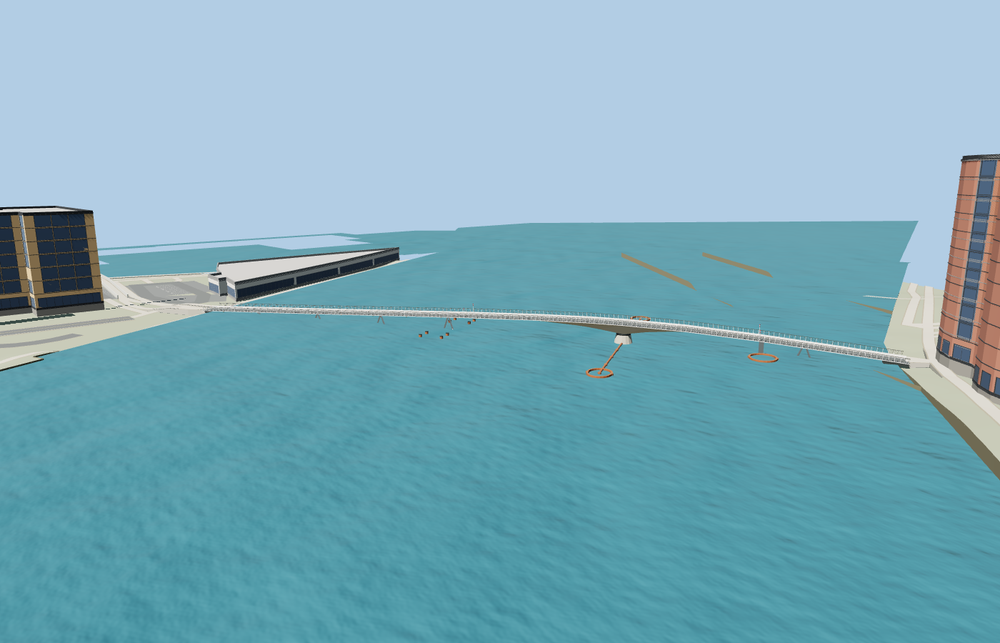

# Bryggebroen

Closed-position Copenhagen harbour swing bridge with a tapered white steel spine, separate walking and cycling lanes, cable railings, splayed pipe bents, a concrete swing bearing, signal posts, and the projecting rust-colored fender system.

The source master has 12,206 triangles. The skyline, district, street, and close-up tiers have 888, 3,854, 9,110, 11,262 triangles. The first two tiers total 356,772 bytes. The close-up tier is 811,596 bytes. Six GLBs passed validation and 34 current views were inspected.

All four tiers pass 18 join probes within 0.15 m and 11 bank approach probes with a maximum difference of 0.004 m. Three checks on the mapped ferry route show at least 3.659 m of rendered headroom and zero obstructions at the test height. Both fender arms are visible above the harbour water. All 12 neighboring buildings and the native road, water, and terrain inputs were retained. Model unload and failed-load fallback both passed.

The mapped 190.968 m envelope and separate footway and cycleway traces locate the closed crossing. Deck grades and visible support, fender and pivot proportions come from ordinary exterior photos and standard Terrarium terrain. Fender freeboard is fitted to the native harbour water in the review. The ferry probes measure rendered clearance in the closed pose. Physical-device timings and surveyed navigation clearance remain unmeasured.

Rebuild with `node packages/worldgen/scripts/generate-bryggebroen.mjs`. Append `--check` to compare exact output bytes. Use `--ids=bryggebroen` for targeted import, LOD, placement, and readiness. The generator is registered in asset-build.json.
