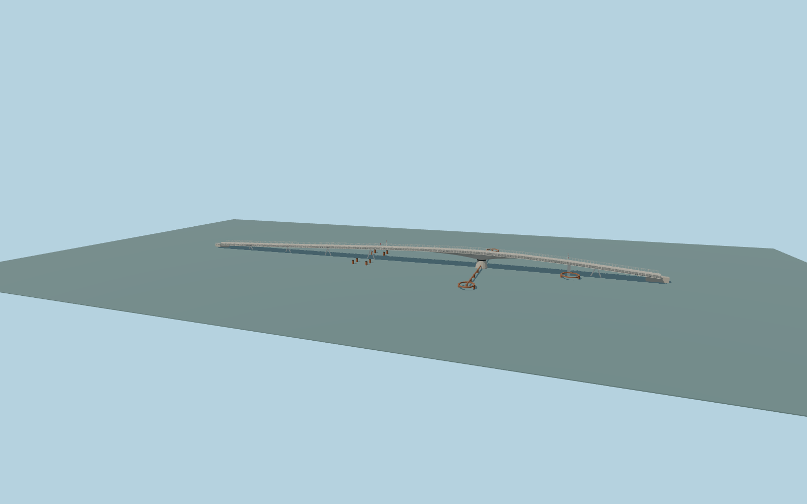

# Bryggebroen

Closed-position Copenhagen harbour swing bridge with a tapered white steel spine, separate walking and cycling lanes, cable railings, splayed pipe bents, a concrete swing bearing, signal posts, and the projecting rust-colored fender system.

Rebuild: `node packages/worldgen/scripts/generate-bryggebroen.mjs`;append `--check` for exact source bytes. Select import/LOD/placement with `--ids=bryggebroen`. Detailed source and four browser tiers are separate ignored GLB outputs.

The mapped outline and path traces establish the crossing and landing positions. The visible supports, fenders, pivot and opening joints are proportioned from exterior photographs.

The deck grades approximate the harbour profile and the original Terrarium bank surfaces. The movable span is depicted in its closed position. The viewer review measures visual clearance and path continuity.

Original geometry:repository license. Map:© OpenStreetMap contributors,ODbL-1.0;Protomaps. Standard terrain:terrain-grid.json. Ordinary pictures stay local and are not redistributed or used as textures. Current acceptance:qa.json.
