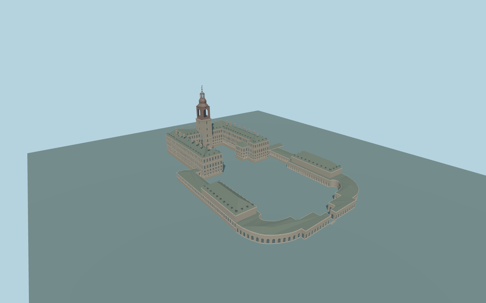

# Christiansborg Palace

Complete principal Christiansborg Palace exterior and exact-way connected riding complex: high asymmetric U, central through-passage/tower, both returned wings/lower risalits, attached low links, complete curved stables/inner arcades and twin riding halls, pitched roofs/dormers/chimneys, recessed white-grid glazing/closed arcade backs and original simplified trim. Tower has a stone base,real open lower arched gallery,curved metal shoulders,open upper lantern,small gold accents andthree original green crown/finial silhouettes. Main court/riding grounds remain open; separate chapel432/437,archive-side gallery516,city andcanals remain native. No copied figures,heraldry,text orinteriors.

Rebuild: `node packages/worldgen/scripts/generate-christiansborg-palace.mjs`;append `--check` for exact source bytes. Select import/LOD/placement with `--ids=christiansborg_palace`. Detailed source and four browser tiers are separate ignored GLB outputs.

Complete principal Christiansborg Palace exterior and exact-way connected riding complex: high asymmetric U, central through-passage/tower, both returned wings/lower risalits, attached low links, complete curved stables/inner arcades and twin riding halls, pitched roofs/dormers/chimneys, recessed white-grid glazing/closed arcade backs and original simplified trim. Tower has a stone base,real open lower arched gallery,curved metal shoulders,open upper lantern,small gold accents andthree original green crown/finial silhouettes. Main court/riding grounds remain open; separate chapel432/437,archive-side gallery516,city andcanals remain native. No copied figures,heraldry,text orinteriors.

Approximate9m standard global DEM reference,main-palace floor11.8m andlow riding-ground floor6.7m. Main eaves28.8m/roof38.6m,low arcades7.7m/roof13.5m,twin halls25.3m andtower105.3m are map/picture-guided heights above that approximate datum. Low facade bases follow a bounded graded plinth between high court andlow riding precinct while roof levels remain fixed. Three small supported approaches use actual standard terrain profiles; the portal floor andlarge open precinct stay native. No surveyed historic elevations orflattened precinct is claimed.

Original medium-fi capitals,crown/finial contours,roof joins andwindow/dormer inventories;exact sculptural ornament is excluded. Two front references show a similar courtyard direction; an older-looking aerial establishes connected range topology andcurrent PMTiles decides fit. Rear/side detail andhistoric grades are approximate. Physical-device timings andnumerical LOD errors remain unmeasured.

Five existing shared256px granite,limestone,copper,painted-wood andwindow-grid graphs; six material slots. Metric UVs/linear colors; no private or embedded images. Four authored browser tiers preserve complete individual U andconnected riding/stable complex,both open precincts,central real through-passage,twin riding halls andopen tiered tower. District window proxies,street real recesses,close-up pilasters/closed dormer hoods/tower trim andfine source cornices/mullions. Physical timings and numerical LOD errors remain unmeasured.

Original geometry:repository license. Map:© OpenStreetMap contributors,ODbL-1.0;Protomaps. Standard terrain:terrain-grid.json. Ordinary pictures stay local and are not redistributed or used as textures. Current acceptance:qa.json.
