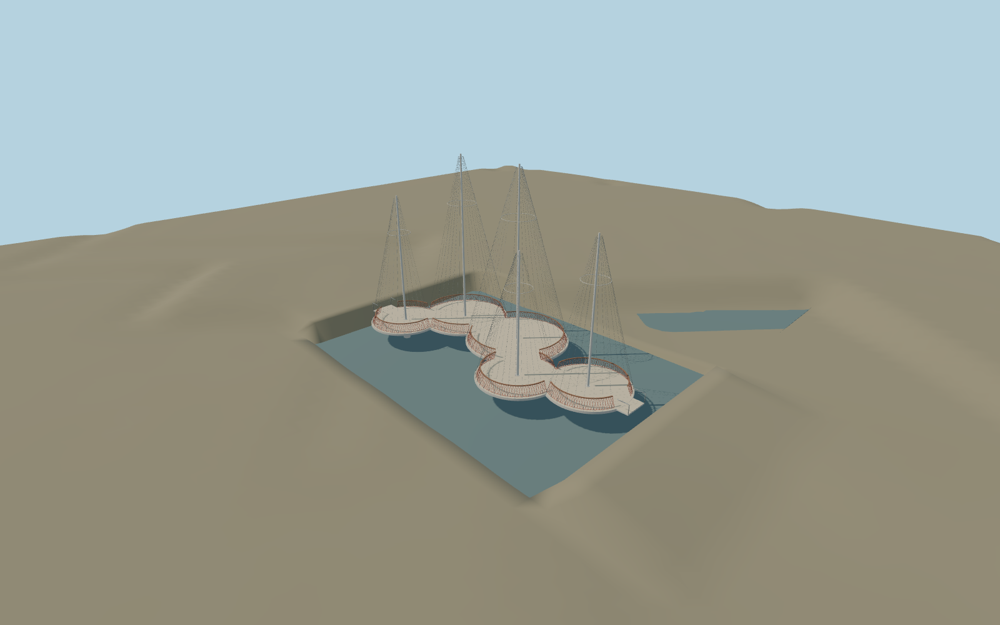

# Circle Bridge (Cirkelbroen)

Compact Cirkelbroen closed exterior with analytically clipped circular decks, flared supports, five unequal white masts, stay rings/cables, red rail and shared wood caps. Original detailed master remains reproducible.

## Evidence

- [Primary reference](https://olafureliasson.net/artwork/cirkelbroen-2015/)
- [Primary reference](https://olafureliasson.net/press/cirkelbroen)
- [Primary reference](https://steelinfo.dk/files/pdf/dsi/steelday_2012/11.%20Cirkelbroen.pdf)
- [Primary reference](https://cdn.archilovers.com/projects/ebb80424-9531-4fd0-811e-656a4b4de7a1.pdf)

Published dimensions and reconstruction assumptions are separated in spec.json. Source photos were consulted; no photos or third-party geometry are embedded. Map plan attribution: © OpenStreetMap contributors, ODbL-1.0.

## Source

50474 triangles; 6059816 bytes; 4 material groups. SHA256: sha256:ed5f2c6834c3334577af9e7a79fbc12bfc903ae8bef17bd84c21814ad0748f61.

Shared surfaces (concrete_plain, metal_painted, metal_stainless, wood_plain) are loaded through the central library; any transparent materials use local PBR parameters. Axis and provisional vertical datum are in spec.json.

Regenerate with node packages/worldgen/scripts/generate-researched-bridges.mjs --ids=circle_bridge; append --check to verify. Import and capture through the standard structure-catalog scripts. Geometry validation does not substitute for current-frame visual review.

## Reconstruction limits

- One actually inspected designer-gallery overview establishes the five staggered cream circular decks, white masts and circular stay rings, red rails and wood caps. Retain authored platform centers/radii and analytic exposed arcs; source is the closed state. Standard viewer PMTiles confirms the Christianshavn canal crossing and northeast direction. Retain approximate harbor origin0m; centerDEM0.9918m includes bridge imprint, no water-stage or quay-threshold survey. The bounded complete outline removes map road/ground only under the successfully loaded crossing. Source-local bed and shore contacts are picture-based preview corrections with raw samples preserved. Long quay ramps, opening mechanism/animation and surrounding buildings remain separate.
- Four canonical shared graphs reused. Skyline uses filled rail ribbons and representative stays. District restores cap/rail posts and mast rings; street/closeup restore woven rail impressions and increasingly dense stays. Closeup keeps118stay positions; bolts, pivots and light fittings simplified. Exact Matacryl coating and Guariuba species use shared concrete/wood approximations. Physical-device timings remain unmeasured.
