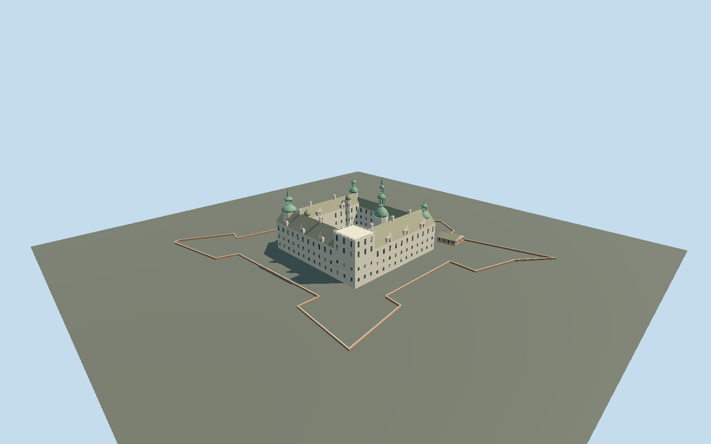

# Kronborg Castle

Four sandstone Renaissance wings around an open courtyard; distinct Trumpeter, Cannon, Kings, lighthouse and Pigeon towers, copper roofs, domed stair turrets, ornate gables, north passage and mapped bastion edges.

## Evidence and reconstruction

Published dimensions and reconstructed details are separated in spec.json. Primary references:

- [Reference](https://www.openstreetmap.org/relation/1588209)
- [Reference](https://kronborg.dk/en/experiences/the-castle-courtyard)
- [Reference](https://kronborg.dk/en/history-of-kronborg)
- [Reference](https://research-api.cbs.dk/ws/portalfiles/portal/58852980/Lise_Llyck.pdf)
- [Reference](https://commons.wikimedia.org/wiki/File:Kronborg_-_Schlossplan.jpg)
- [Reference](https://commons.wikimedia.org/wiki/File:KronborgCastleDenmarkOct152022_03.jpg)
- [Reference](https://commons.wikimedia.org/wiki/File:Kronborg_flygfoto_1,_2021.jpg)
- [Reference](https://commons.wikimedia.org/wiki/File:Kronborg_Courtyard_2018a.jpg)
- [Reference](https://commons.wikimedia.org/wiki/File:Kronborg_Courtyard_2018b.jpg)

No third-party geometry, photograph or bitmap texture is embedded. Shared surface graphs come from the central library; vertex tints carry model colors. Glazing uses PBR materials; transparent surfaces are declared per model.

## Model and axes

22,120 triangles; 43,704 vertices; 7 material groups; 1,842,988 bytes. Native bounds: -109.667, -4.800, -92.288 to 104.598, 59.000, 91.747. Source hash: `sha256:48427727465e6fde6e07fc6324bb91809f67415926f38f4e84a6253775b81368`.

{"up":"+Y","longitudinal":"+X approximately north","front":"+Z approximately east","origin":"Exact-Q189358 component frame;Y0 reconstructed courtyard floor."}

Fresh exact-Q189358 relation1588209 and13 component ways agree with retained source vertices within1mm. Native+X5.043deg points north;+Z95.043deg points east. Mapped lighthouse node1400918158/Q20042645 fixes north-east corner,chapel fixes south-east and the flat Cannon tower lies south-west; signed entrance points north. ModelY0 is reconstructed courtyard floor,Trumpeter top59m above it. Site absolute datum is not claimed; CBS62m above water implies3m courtyard-to-water,not a survey. Occupied walls extend4.8m below the relative floor; curtain walls are narrow masonry with estimated1.2m crest. Ground-contact policy uses courtyard-relative host terrain. No land plinth,whole-precinct replacement,moat excavation or synthetic ground presented as measured Danish DHM.

## Reproduce

Run `node packages/worldgen/scripts/generate-signature-towers.mjs --ids=kronborg_castle` (or add `--check`). The generator preserves manually edited masters by checking their baseline hashes. Import through the standard authored-model workflow with optimization disabled; then capture all QA cameras, including shared-surface views.

## Pending work

- Original detailed337000-triangle/28246264-byte master remains exactly reproducible atsha256:19d963e651b26285ce37f136aac82dd41fe21fb689ca37b4cd863a8501e18e9a from kronborg-castle-model.mjs#kronborgStudy.build. Independent reviewed browser geometry uses courtyard origin,buried foundations,narrow masonry and continuous north gate paving.
- Fresh exact-Q189358 relation1588209 and13 component ways agree with retained source vertices within1mm. Native+X5.043deg points north;+Z95.043deg points east. Mapped lighthouse node1400918158/Q20042645 fixes north-east corner,chapel fixes south-east and the flat Cannon tower lies south-west; signed entrance points north. ModelY0 is reconstructed courtyard floor,Trumpeter top59m above it. Site absolute datum is not claimed; CBS62m above water implies3m courtyard-to-water,not a survey. Occupied walls extend4.8m below the relative floor; curtain walls are narrow masonry with estimated1.2m crest. Ground-contact policy uses courtyard-relative host terrain. No land plinth,whole-precinct replacement,moat excavation or synthetic ground presented as measured Danish DHM.
- Medium-fi exterior reconstruction: other tower and wall heights,window spacing,gable scrolls,roof junctions and stair turret profiles are proportional estimates. Royal figurative reliefs,inscriptions,clock faces and weathering patches are simplified.
- Full crownwork,ravelins,coastal batteries,landscape,moat and interiors are supplied by other layers or omitted. No copied photos or individually modeled stone joints. Shared sandstone,copper,granite,brick,timber and painted-metal graphs plus opaque PBR glass.
- Public national Danish DHM requires API-key access; no numeric DHM was retrieved. Relative courtyard contact and occupied foundations are reviewed; exact terrain slopes,absolute sea/vertical datum and every defensive wall ground fit remain unverified. Physical laptop/phone timings remain pending.

This bundle follows the medium-fi standard. Medium-fi appearance and geographic fit are reviewed separately. Hash-bound visual acceptance is recorded separately after capture inspection.

## Additional geographic data

Map geometry © OpenStreetMap contributors, ODbL-1.0. Linked photographs are reference only; no third-party mesh or pixels distributed.
