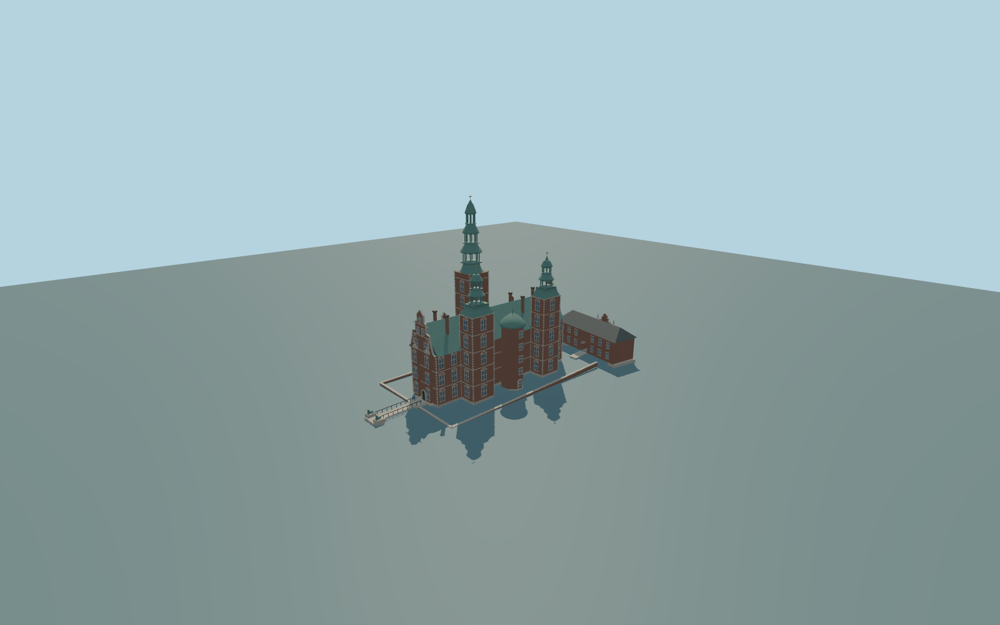

# Rosenborg Castle

Complete current principal Rosenborg castle exterior and separate northwest gatehouse:long red-brick/stone-banded copper-gabled block,paired NE square towers/central faceted stair dome,tall SW tower with staged open lanterns,scroll gables/dormers/end oriels,chimneys,closed exterior entry doors,gatehouse open arch and skewed native plan,short mapped gatehouse approach,east bridge/rails with original lion/plinth cues,and low perimeter segments. Water/gardens,interiors,future underground treasury and independent park/street buildings are excluded.

Rebuild: `node packages/worldgen/scripts/generate-rosenborg-castle.mjs`;append `--check` for exact source bytes. Select import/LOD/placement with `--ids=rosenborg_castle`. Detailed source and four browser tiers are separate ignored GLB outputs.

Complete current principal Rosenborg castle exterior and separate northwest gatehouse:long red-brick/stone-banded copper-gabled block,paired NE square towers/central faceted stair dome,tall SW tower with staged open lanterns,scroll gables/dormers/end oriels,chimneys,closed exterior entry doors,gatehouse open arch and skewed native plan,short mapped gatehouse approach,east bridge/rails with original lion/plinth cues,and low perimeter segments. Water/gardens,interiors,future underground treasury and independent park/street buildings are excluded.

No native vertical tags. Original picture-proportional reconstruction scaled to47.04m plan:main eave13.5m/ridge20.4m,paired tower walls22.5m/tips34.8m,central stair dome21.6m and great tower wall28.5m/tip49.2m. These are approximate envelopes,not surveyed as-built heights. Roof/lantern/window/statue/scroll/grade inventories remain original approximations.

Native129x129/2m field covers256m,8m rounded datum,one coarse global tile. All foundations/threshold/accessibility grades approximate. Fine bronze lion/statuary/scroll/symbol and window inventories are original simplified cues,not replicas. Perimeter segments are original picture/footway interpretations,not surveyed walls. Near thresholds and bridge decking levels approximate.

Six existing256px brick,limestone,copper,ceramic-tile,window-grid andpainted-metal graphs;metric UVs/linear vertex colors. No private/new/embedded images or copied lettering/reliefs. Closed opaque original entry doors exclude reconstructed optical interiors. Statuary/lions/scroll/finial/window andchimney inventories simplified original interpretations. Source master preserves denser outlines/roof seams/ornament. Far uses coarse gable/dormer/foundation and lantern-post forms,omits subpixel perimeter/sculpture/rails;district simplifies ornament;actual gatehouse arch and major open lantern stages remain. Error estimates4/2/1/.35m are not measured mesh distances. Physical phone/laptop/dense-city timings remain unmeasured.

Original geometry:repository license. Map:© OpenStreetMap contributors,ODbL-1.0;Protomaps. Standard terrain:terrain-grid.json. Ordinary pictures stay local and are not redistributed or used as textures. Current acceptance:qa.json.
