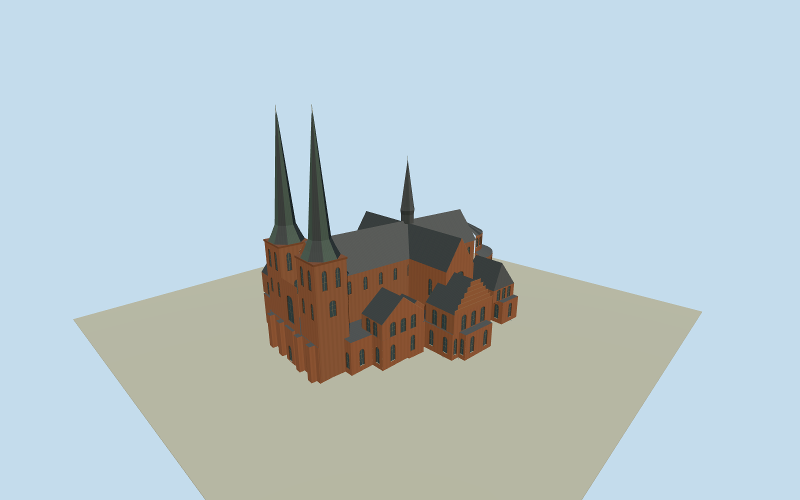

# Roskilde Cathedral

Roskilde Cathedral’s Gothic brick nave, paired west spires, smaller Margrete spire, rounded apse and separately roofed royal chapels.

Authoring state: **review-in-qa.json**. Current completion evidence is in [qa.json](qa.json) and the [completion ledger](../../../../qualla-structures/batches/qualla-003.PROGRESS.md).

- [Roskilde Cathedral](https://qualla.com/roskilde-cathedral/)

The July 2019 exterior model covers the cathedral, attached chapels and the separately mapped open memorial enclosure. Interior details and neighboring buildings are outside scope.

The released photos document the east end and side. The opposite elevations, some chapel roof junctions and fine tracery are estimates based on the mapped envelope and heritage descriptions.

The west spires use the cathedral’s current visitor guide measurement of 75.5 metres. An older source provides a different figure. Other section heights and grade details are approximate.

Build: `node content/worldgen/source/places/u3/u3b/roskilde_cathedral/models/generate-roskilde-cathedral.mjs`. Add `--check` to verify exact regeneration. 16853 triangles; 5 materials; no embedded photographs.
