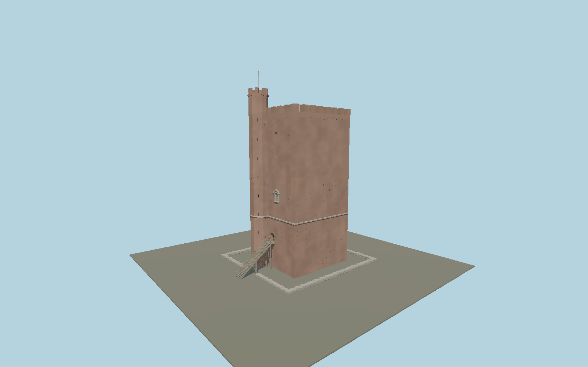

# Kärnan

Helsingborg’s brick keep with its asymmetric octagonal stair turret, eight merlons per main elevation, recessed windows and putlog holes, sandstone belt, raised timber entrance, projecting northwest privy shaft, open roof terrace and low collar-wall remnants. Shared metric materials and original continuous brick weathering.

## Identity and geometry

Catalog karnan, [Q1779457](https://www.wikidata.org/wiki/Q1779457). Mapped main plan is about15.8×16.3 m, compared with the city’s approximately15 m description. Main crenellations reach the mapped34.5 m. Current photographs establish the taller turret and individual facade layouts; turret38.5 m and5.8 m entrance are provisional proportional reconstruction. The1893 section predates restoration, and operator floor labels are not substituted for surveyed exterior datums.

Native-X faces southwest toward the city/sea; native-Z is the northwest privy side; native+Z southeast. Exact-Q1779457 way236992894 contains the asymmetric stair-turret projection. Hikuin19 article p43 explicitly names southwest principal facade/stair turret and northwest privy; inspected Fig2 plan and current2015/2025 exterior photos agree. Heading0.909308291221rad follows the mapped long edge, not a surveyed azimuth;±3degree map/photo estimate.. Native -X faces southwest toward the city and sea; native -Z is the northwest privy elevation, +Z southeast.; +Y is up. The geographic proposal identifies its anchor and orientation evidence separately from remaining terrain and azimuth uncertainty.

Source facts and measured references are recorded in spec.json. References: [1](https://helsingborg.se/uppleva-och-gora/kultur-och-museer/the-keep-of-helsingborg/), [2](https://karnan.se/om-karnan/utforska-karnan/), [3](https://stadslexikon.helsingborg.se/krnan/), [4](https://tidsskrift.dk/Hikuin/article/download/149897/192728/330000), [5](https://media.helsingborg.se/uploads/networks/1/2015/02/Bevprogram_HBG_Stadskarna_AtillJ_2002_sbf.pdf), [6](https://www.flickr.com/photos/helsingborgsmuseer/28102443388/in/album-72157690814895900), [7](https://commons.wikimedia.org/wiki/File:K%C3%A4rnan_1.jpg), [8](https://commons.wikimedia.org/wiki/File:K%C3%A4rnan_7.jpg), [9](https://commons.wikimedia.org/wiki/File:K%C3%A4rnan_2025.jpg), [10](https://www.openstreetmap.org/way/236992894). Reference pages and images are not redistributed.

## Original source and shared materials

Geometry is authored in `packages/worldgen/scripts/karnan-model.mjs`. Shared material graphs with metric repeat UV0 and original vertex tints; GLB PBR fallback remains self-contained. No per-model texture duplication. No third-party mesh or photograph is embedded.

76,762 triangles; 91,398 vertices; 7 material groups; 4,215,664 source bytes. Source hash: `sha256:61cf21c5bf16a87254076fb19933f193888cbe3ad4b121e93fd049b16f1b05cb`. Geometry validation checks finite Float32 coordinates, indices, triangle area and winding before export.

Regenerate with `node packages/worldgen/scripts/generate-heritage-towers.mjs karnan`; add `--check` for reproducibility. The generator refuses to overwrite a master whose hash differs from source.json. Import uses `--no-optimize` to preserve facade recesses.

## Remaining detail and review

- Static restored exterior: main34.5m battlements and approximately15m plan are city/preservation documented;38.5m turret,44.08m mast,5.8m threshold and minor openings are photographic proportions. Original detailed source is preserved. Current collar-wall remnants and timber approach are approximate plan/photo reconstructions, not surveyed ruins or terrain. Shared brick provides canonical repeating joints with original weathering in the detailed source; no scan or copied individual brick repair. Browser skyline uses facade marks, district omits subpixel putlog holes, street uses original flat dark marks, close-up retains physical putlog/window recesses. Small roof paving joints are averaged into an intact floor. Hidden interiors, archaeological predecessor, distant Terrace Stairs, landscape and temporary visitor equipment are excluded. Host must fit terrain contact locally; footprint replacement is disabled.

Named near/far cameras are included for lit visual review. A valid export is not maximum-fidelity certification.
