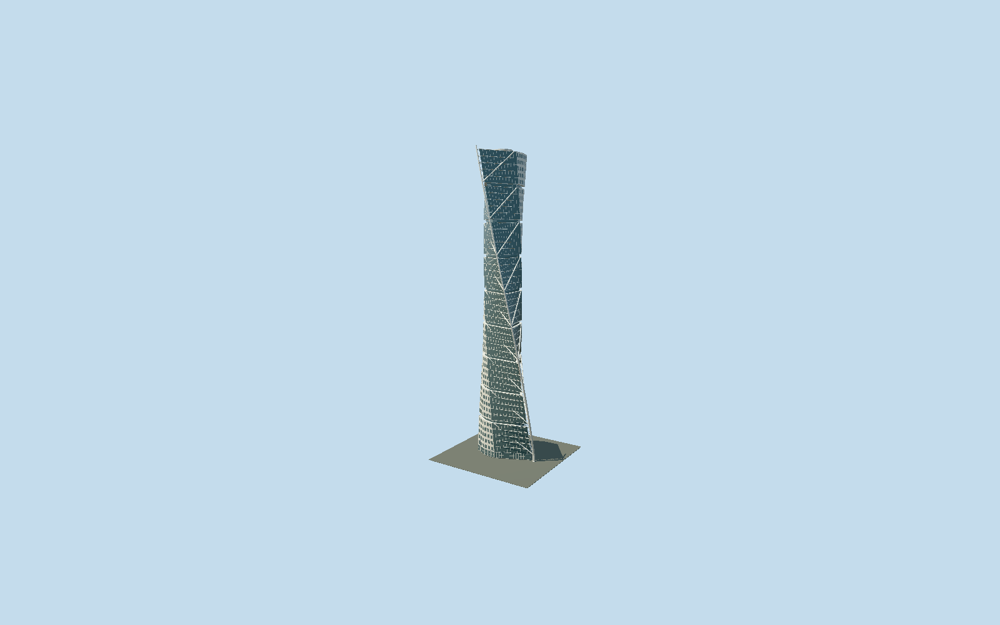

# Turning Torso

Complete nine-unit white twisting tower with punched windows, exposed glass triangular wing, separate steel spine, visible circular service crown and mapped southwest arrival.

## Evidence and reconstruction

Published dimensions and reconstructed details are separated in spec.json. Primary references:

- [Reference](https://calatrava.com/projects/turning-torso-malmoe.html)
- [Reference](https://www.hsb.se/turningtorso/)
- [Reference](https://www.hsb.se/omhsb/goda-exempel/hsb-malmo---turning-torso-certifierad-med-miljobyggnad-idrift-silver/)
- [Reference](https://www.openstreetmap.org/way/30926877)

No third-party geometry, photograph or bitmap texture is embedded. Shared surface graphs come from the central library; vertex tints carry model colors. Glazing uses PBR materials; transparent surfaces are declared per model.

## Model and axes

47,984 triangles; 118,292 vertices; 4 material groups; 4,837,136 bytes. Native bounds: -22.805, 0.000, -16.264 to 21.916, 190.000, 24.893. Source hash: `sha256:67c94b37520fbf33eb6691ba8eb2d3c10d1a80721971fd2681b78fbf385d96a5`.

{"up":"+Y","longitudinal":"+X northeast ground wing/spine","front":"-X southwest Lilla Varvsgatan14 entrance","origin":"Ground contact in exactQ206435 mapped frame"}

The geographic proposal uses exact-QID OpenStreetMap evidence. Map-derived orientation and estimated architectural details require real-site visual review; preview eligibility is distinct from geographic/fidelity approval. Map attribution: © OpenStreetMap contributors, ODbL-1.0.

## Reproduce

Run `node packages/worldgen/scripts/generate-signature-towers.mjs --ids=turning_torso` (or add `--check`). The generator preserves manually edited masters by checking their baseline hashes. Import through the standard authored-model workflow with optimization disabled; then capture all QA cameras, including shared-surface views.

## Pending work

- Complete medium-fi Turning Torso tower retains nine five-floor twisted units, recessed interstitial bands, independent circular core,90degree sweep and separate spiraling external steel spine. Original62506-triangle master recipe is preserved unchanged and reproducible. Reviewed source corrects the two triangular-wing elevations to exposed dark curtain glazing, as seen in architect photos03/06/08, retaining punched windows within white aluminum on the broad elevations. Last-unit roof188m leaves the circular service crown visible to published190m; tiny tube tips are clipped to190m. Nine equal cycles and exact window counts remain original reconstruction rather than measured floor levels. Primary architect publishes190m,10.6m core inner diameter with2.5m base/.4m top wall, curved aluminum and flat glass; owner confirms nine units/five floors/54including intermediate levels and90degree twist. Mapped entrance gets reconstructed paired glazing, handles and short granite arrival path; no surveyed doorway hardware or threshold. Three canonical shared granite/concrete/painted-metal graphs; palette PBR glass; no copied or embedded photographs. Closeup retains fine facade joints, truss and floor struts; street drops tiny joints/frames and reduces tube facets; district merges broad window strips and retains major truss plus two pairs of floor struts per unit; skyline retains whole asymmetric twisted mass, nine bands, exposed glass wing, separate major spine/diagonals and core crown while omitting minor struts/windows. Separate Turning Torso Gallery parking parcel and its corridor, reflecting pool, surrounding canal, interior, temporary construction and exact panel curvature are outside this tower bundle; they are disclosed site context, not missing tower parts. Base and upper outlines follow unchanged map controls; upper overhang is intentional. Ground grade, night and physical-device timing/full-scene memory unmeasured.

This bundle follows the medium-fi standard. Medium-fi appearance and geographic fit are reviewed separately. Hash-bound visual acceptance is recorded separately after capture inspection.
