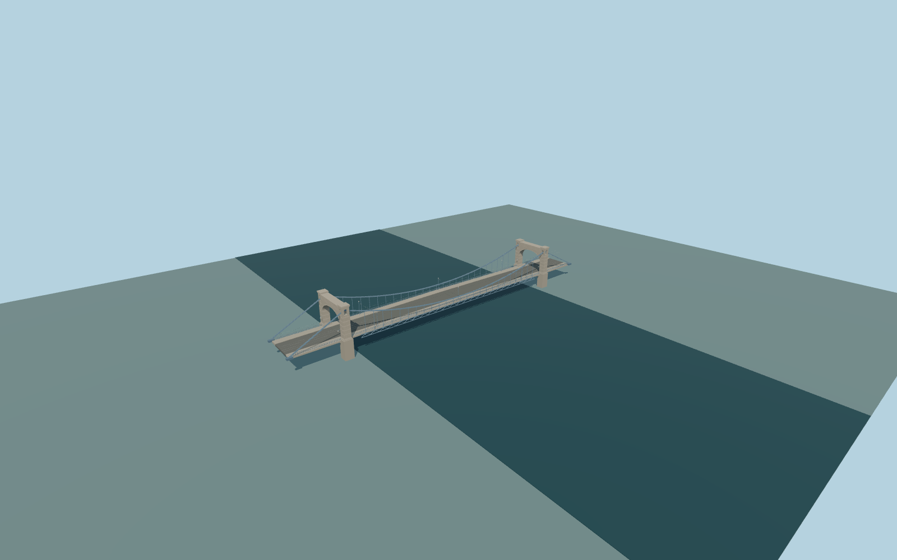

# Grunwald Bridge

Light-blue flat-band suspension bridge with two massive granite arched gateways, open upper suspension-band chambers, vertical hangers, lower deck trusses, twin tram tracks and separate pedestrian rails.

Original deterministic source: models/grunwald-model.mjs, alignment.json and checked-in picture observations/map/terrain controls. Rebuild with `node packages/worldgen/scripts/generate-grunwald-bridge.mjs`; append `--check` for exact bytes. Standard targeted import and LOD commands select `--ids=grunwald_bridge`. GLBs are ignored build outputs.

Five existing shared256px material graphs;no private textures. Native standard-viewer terrain, exact signed river-deck footprint, paired tram centerlines and adjacent bank roads are retained. The112.5m suspended roadway,126.6m portal separation and176m authored approach/backstay extent are distinct. See model-brief.json for reconstruction limits and qa.json for inspected current acceptance. Exact quay/road grades, foundations and original connection dimensions remain unsurveyed.

Original geometry uses the repository license. Map-derived controls: © OpenStreetMap contributors, ODbL-1.0;Protomaps basemap. Standard terrain attribution and raw tile hashes are in terrain-grid.json. Linked photographs are references, not redistributed or used as textures.
