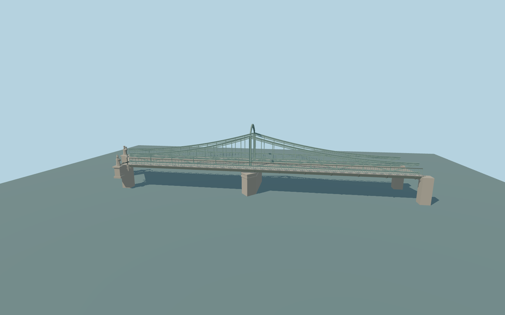

# Tumski Bridge

Tumski Bridge exterior: two open low lattice side girders, curved upper side chords and vertical hangers, one curved central overhead lattice portal, two open river spans over a cutwater pier, skewed bank bearings, separate outer walks, slim railings, two robed stone entrance statues on pedestals and paired gas lamps.

Rebuild: `node packages/worldgen/scripts/generate-tumski-bridge.mjs`;append `--check` for exact source bytes. Select import/LOD/placement with `--ids=tumski_bridge`. Detailed source and four browser tiers are separate ignored GLB outputs.

Fixed 110 m datum and approximate 113.8 m deck. Standard terrain samples 110.150 m review water. Sculptures, steel sections, deck elevation and buried foundations are ordinary-photo approximations.

No interiors, moving traffic, individual padlocks, readable inscriptions or exact sculptural likenesses. The two stone figures are modeled in the round as medium-fi exterior forms. No photograph pixels or downloaded meshes are used. Physical laptop and phone performance measurements remain pending.

Original geometry:repository license. Map:© OpenStreetMap contributors,ODbL-1.0;Protomaps. Standard terrain:terrain-grid.json. Ordinary pictures stay local and are not redistributed or used as textures. Current acceptance:qa.json.
