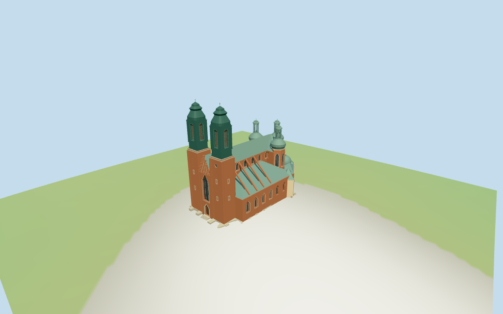

# Archcathedral Basilica of St. Peter and St. Paul

Individual Poznań Cathedral:two tall western red-brick towers with narrow lower fields,one front clock,dark oxidized-copper louvered belfry stages and tiered Baroque caps/crosses. Deep pointed central portal/window field beneath stepped Gothic brick gable with slender pale recessed panels. Long buttressed brick nave and green pitched roof;three smaller faceted eastern choir towers with pointed glazing,swelling copper roofs,actual open lanterns and onion/cross tips. Lower pale ambulatory/chapels include projecting green-domed eastern chapel,pilasters,round-headed windows and small supported geometric figures. Five existing shared brick/stone/copper/wood/plaster graphs and four browser levels. Fine sculpture/inscriptions,interiors and surveyed ground/threshold joins simplified or excluded.

## Evidence and reconstruction

Published dimensions and reconstructed details are separated in spec.json. Primary references:

- [Reference](https://commons.wikimedia.org/wiki/File:Katedra_Poznan_front.jpg)
- [Reference](https://commons.wikimedia.org/wiki/File:Katedra_od_po%C5%82udnia_Pozna%C5%84_RB1.JPG)
- [Reference](https://commons.wikimedia.org/wiki/File:Katedra_p.w._%C5%9B%C5%9B._Piotra_i_Paw%C5%82a_w_Poznaniu.jpg)
- [Reference](https://commons.wikimedia.org/wiki/File:Katedra_Pozna%C5%84ska_w_porannej_mgle_z_lotu_ptaka,_02.03.2026,_Lesiex.jpg)

Five existing cached256-square running-bond brick,continuous limestone,oxidized copper,plain wood and lime-plaster graphs.Linear brick/pale-stone/green-copper/wood/cream tints,metric UVs and flat architectural normals.Glass,clock hands and small metal tips use geometric PBR colors.No embedded images,bespoke facade maps or baked shadows.

## Model and axes

24,318 triangles; 72,954 vertices; 7 material groups; 2,922,276 bytes. Native bounds: -40.848, -1.602, -20.837 to 40.372, 63.000, 23.269. Source hash: `sha256:8896b5e802d1b31fece20e0892e04ab71fd21abec777bf0591296a0e8fb5fa86`.

{"x":"east-northeast from twin-tower facade toward faceted choir","y":"up","z":"south-southeast across nave/chapels"}

Standard viewer DEM datum59.888618m;estimated floor1m,raw whole perimeter-1.25..0.91m. Coarse urban DEM is not a floor survey. Footings crossY=0 and extend below raw terrain;front landing/stairs are approximate. No preview flattening or host DEM change. Runtime foundation exposure/base clipping,exact plaza/street/door contact,absolute altitude and walking remain unverified. No road replacement.

## Reproduce

Run `node packages/worldgen/scripts/generate-additional-landmarks.mjs --ids=N0386` (or add `--check`). The generator preserves manually edited masters by checking their baseline hashes. Import through the standard authored-model workflow with optimization disabled; then capture all QA cameras, including shared-surface views.

## Pending work

- Retained exact-QID way/279545051/Q2064095 matches current whole35184651633883. Current114-vertex whole and23 component controls retain all337 vertices and raw tags rigidly with no rescale. Raw whole height0.1m is an envelope/base tag,not the cathedral roof height,and remains intact. Two large western tower controls52m and two small roof-tip controls62m;three eastern tower controls44m;nave/front35m;aisles24m;four narrow cross-nave controls28m;lower chapels/ambulatory11.2..18m remain verbatim. Existing Wikidata length72m and width36m are retained with unspecified scope;the mapped whole about80.6x44.1m includes projecting chapels,buttresses and porches,so it is not rescaled to those facts. No retained overall-height statement. Main long north nave edge refines heading0.320371545621 to0.399652257489rad (+4.542450deg);native-X west-southwest twin-tower facade and+X east-northeast faceted choir sign the axis. Modeled tower tips62m and rear lantern tips44m,central roof35m,lower aisle ridge24m and chapel caps13.9/15/17/18m interpret raw heights as overall caps above an estimated1m floor. Intermediate stages are picture estimates:western brick shafts36m,green belfries52m,upper roof60.5m/cross62m;choir tower brick29m,bulb35m,open lantern41.2m/onion43.1m/cross44m;nave walls27m and low aisle walls13m. Exact height datum,hidden nave/window rhythm,internal divisions and roof profiles are unverified.
- Standard viewer DEM datum59.888618m;estimated floor1m,raw whole perimeter-1.25..0.91m. Coarse urban DEM is not a floor survey. Footings crossY=0 and extend below raw terrain;front landing/stairs are approximate. No preview flattening or host DEM change. Runtime foundation exposure/base clipping,exact plaza/street/door contact,absolute altitude and walking remain unverified. No road replacement.
- Medium-fi exterior from actually inspected undated front,2006 and2012 eastern exteriors and a distant2026 aerial used only for broad silhouette,plus standard viewer PMTiles/DEM.No bespoke plans/surveys researched or photographs redistributed.Hidden side/nave bay rhythm,stage/eave levels,exact compound roof profiles,upper-body hull,plaster tone and sculpture remain picture estimates.Fine inscriptions,sculptural identity and interiors simplified or excluded.Adjacent buildings,gardens/trees and actual street surfaces remain host content.Physical phone/laptop timing pending.
- Skyline preserves five-tower silhouette,stepped front,green roof/chapel family and actual simplified open rear lanterns.District adds shared surfaces,flat fields/cornices and recessed central portal.Street adds recessed selected glazing/louvers,arch frames,pilasters,buttresses and small supported geometric figures;some alternating low aisle/chapel fields remain flat.Closeup/master add all field recesses,finer opening/roof profiles and louver rows.Synthetic cottages are fixtures.

This bundle follows the medium-fi standard. Medium-fi appearance and geographic fit are reviewed separately. Hash-bound visual acceptance is recorded separately after capture inspection.

## Additional geographic data

©OpenStreetMap contributors;Protomaps;Mapzen/USGS terrain tiles.
